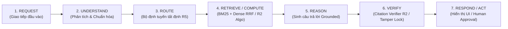
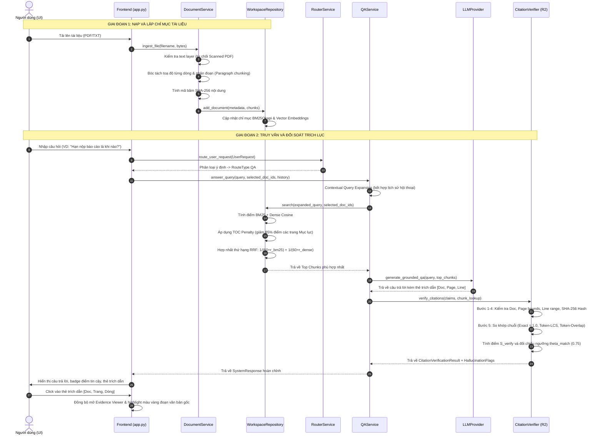
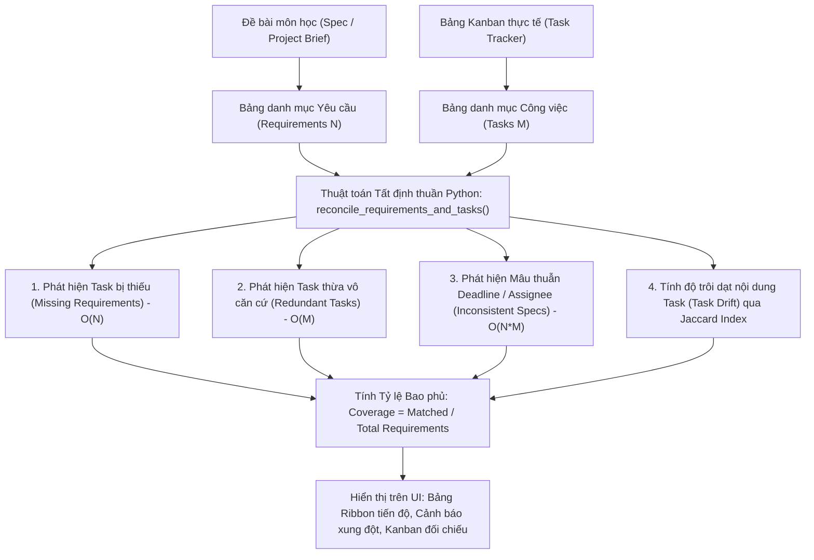
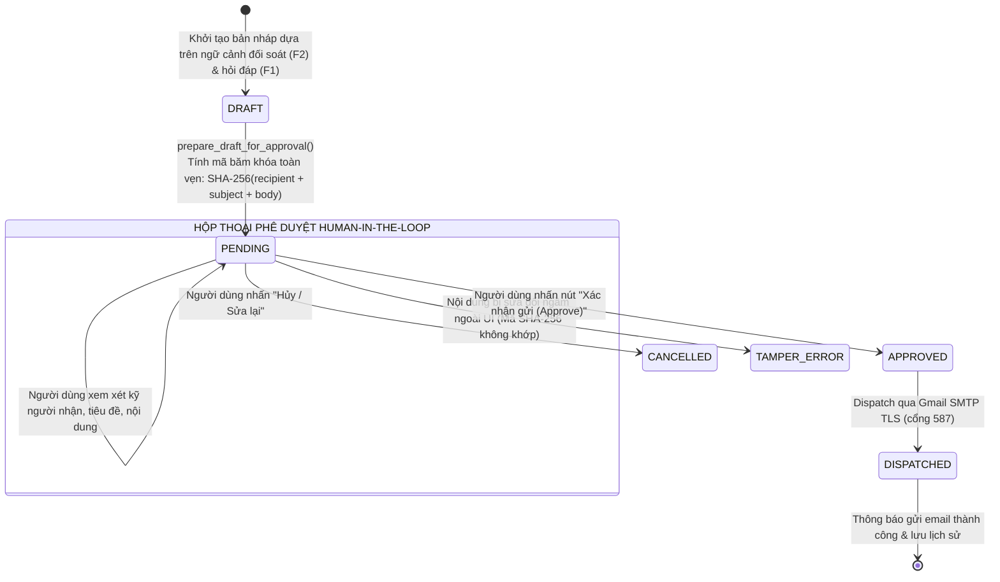

# WORKSPACEAI — BÁO CÁO TOÀN DIỆN HỆ THỐNG: MÃ NGUỒN, Ý NGHĨA, CÔNG NGHỆ & LUỒNG HOẠT ĐỘNG

**Dự án:** WorkspaceAI – Intelligent Document Workspace with Cross-Document Reconciliation & Human-Approved Email Actions  
**Học phần:** CSC10014 – Computational Thinking (Tư duy Tính toán)  
**Đơn vị:** Khoa Công nghệ Thông tin – Trường Đại học Khoa học Tự nhiên, ĐHQG-HCM (FIT@HCMUS)  
**Chủ đề (Track):** Track C – Intelligent Document Workspace  
**Thời gian cập nhật:** Tháng 11/2026  
**Trạng thái kiểm thử:** 13/13 tests PASSED (100% tỷ lệ vượt qua)  

---

## MỤC LỤC TỔNG QUAN

1. [Phần I: Tổng quan Kiến trúc & Nguyên lý Thiết kế](#phần-i-tổng-quan-kiến-trúc--nguyên-lý-thiết-kế)
2. [Phần II: Sơ đồ Cấu trúc Cây Thư mục](#phần-ii-sơ-đồ-cấu-trúc-cây-thư-mục)
3. [Phần III: Chi tiết Từng Thư mục trong Hệ thống](#phần-iii-chi-tiết-từng-thư-mục-trong-hệ-thống)
4. [Phần IV: Bảng Chi tiết 100% Từng Tệp Tin (Nội dung, Ý nghĩa, Công nghệ)](#phần-iv-bảng-chi-tiết-100-từng-tệp-tin)
   - [1. Nhóm Cấu hình Gốc & Đóng gói Docker](#1-nhóm-cấu-hình-gốc--đóng-gói-docker)
   - [2. Thư mục `.skills/` (Bộ Quy chuẩn Kiến trúc)](#2-thư-mục-skills)
   - [3. Thư mục `.streamlit/` (Giao diện Frontend)](#3-thư-mục-streamlit)
   - [4. Thư mục `backend/algorithms/` (Thuật toán Thuần R2)](#4-thư-mục-backendalgorithms)
   - [5. Thư mục `backend/core/` (Cấu hình, Dữ liệu, Bảo vệ)](#5-thư-mục-backendcore)
   - [6. Thư mục `backend/repositories/` (Kho Lưu trữ & Chỉ mục Tìm kiếm)](#6-thư-mục-backendrepositories)
   - [7. Thư mục `backend/providers/` (Tích hợp AI & Nhúng Vector)](#7-thư-mục-backendproviders)
   - [8. Thư mục `backend/services/` (Tầng Nghiệp vụ Phối hợp)](#8-thư-mục-backendservices)
   - [9. Thư mục `backend/api/` & `backend/main.py` (Tầng REST API)](#9-thư-mục-backendapi--backendmainpy)
   - [10. Thư mục `frontend/` (Giao diện Người dùng Tương tác)](#10-thư-mục-frontend)
   - [11. Thư mục `tests/` (Hệ thống Kiểm thử Tự động)](#11-thư-mục-tests)
5. [Phần V: Logic và Luồng Hoạt động Xuyên suốt Từng Thư mục](#phần-v-logic-và-luồng-hoạt-động-xuyên-suốt-từng-thư-mục)
   - [1. Đường ống 7 bước CSC10014 (The 7-Step Pipeline)](#1-đường-ống-7-bước-csc10014)
   - [2. Luồng Feature 1: Evidence-Grounded Q&A](#2-luồng-feature-1-evidence-grounded-qa)
   - [3. Luồng Feature 2: Cross-Document Reconciliation](#3-luồng-feature-2-cross-document-reconciliation)
   - [4. Luồng Feature 3: Context-Aware Email Assistant](#4-luồng-feature-3-context-aware-email-assistant)
   - [5. Luồng Bảo vệ An toàn & Điều phối (R5 Router & R7 Safeguards)](#5-luồng-bảo-vệ-an-toàn--điều-phối)
   - [6. Luồng Vận hành Đóng gói Docker](#6-luồng-vận-hành-đóng-gói-docker)
6. [Phần VI: Bảng Tổng hợp Công nghệ & Thư viện Toàn Dự án](#phần-vi-bảng-tổng-hợp-công-nghệ--thư-viện-toàn-dự-án)

---

## PHẦN I: TỔNG QUAN KIẾN TRÚC & NGUYÊN LÝ THIẾT KẾ

### 1. Giới thiệu Dự án
WorkspaceAI là nền tảng quản lý không gian làm việc tài liệu thông minh dành cho sinh viên và giảng viên đại học, tập trung giải quyết 3 bài toán lớn trong làm việc nhóm học thuật:
1. **Hỏi đáp có trích dẫn đã xác thực (Evidence-Grounded Q&A):** Trả lời câu hỏi học thuật dựa trên tài liệu lớp học/đề bài với định vị toạ độ chính xác tới từng dòng `[Tài liệu, Trang, Dòng bắt đầu - Dòng kết thúc]` và hiển thị văn bản gốc để soi chiếu.
2. **Đối soát chéo tài liệu (Cross-Document Reconciliation):** Tự động phát hiện độ lệch giữa yêu cầu trong tài liệu đề tài (Project Brief/Spec) và bảng phân công công việc thực tế (Task Tracker/Kanban).
3. **Trợ lý soạn thảo email có phê duyệt của con người (Context-Aware Email Assistant with Human-in-the-Loop):** Tự động tổng hợp tiến độ để tạo bản nháp email báo cáo gửi giảng viên hướng dẫn, khóa nội dung bằng mã băm SHA-256 và chỉ gửi đi khi có sự phê duyệt trực tiếp của con người.

### 2. Năm Nguyên tắc Kiến trúc Cốt lõi (Core Principles)
* **Nguyên tắc 1: AI là một bộ phận tính toán, không phải toàn bộ hệ thống.**  
  LLM không được trao quyền tự do quyết định toàn bộ hệ thống. Mọi luồng đi qua bộ định tuyến tất định (Deterministic Router R5).
* **Nguyên tắc 2: Không mặc định tin tưởng đầu ra của LLM.**  
  Bất kỳ trích dẫn nào do LLM đưa ra đều bị coi là giả định và bắt buộc phải đi qua Thuật toán Kiểm chứng Trích dẫn (Citation Verifier R2) đối soát trực tiếp trên văn bản gốc.
* **Nguyên tắc 3: Thuật toán tất định (R2 Algorithms) độc lập tuyệt đối (100% Pure Python stdlib).**  
  Tất cả các thuật toán tại `backend/algorithms/` chỉ sử dụng thư viện chuẩn của Python (`math`, `re`, `hashlib`, `difflib`, `collections`, `typing`). Nghiêm cấm import các framework bên thứ ba như FastAPI, Pydantic, Pandas hay Streamlit vào thư mục này để đảm bảo tính cô lập, kiểm thử nhanh và không bị ràng buộc nền tảng.
* **Nguyên tắc 4: Mọi nhận định đều phải truy xuất được nguồn gốc (Full Traceability).**  
  Mọi câu khẳng định phải kèm theo ID tài liệu, số trang, khoảng dòng, phiên bản tài liệu và mã băm toàn vẹn nội dung.
* **Nguyên tắc 5: Cổng an toàn có sự kiểm soát của con người (Human-in-the-Loop Safeguard).**  
  Hành động gửi email và ghi nhận công việc không thể tự ý kích hoạt ngầm; giao diện Streamlit hiển thị hộp thoại duyệt bản nháp minh bạch.

---

## PHẦN II: SƠ ĐỒ CẤU TRÚC CÂY THƯ MỤC

```text
WorkspaceAI_Local_Skeleton/
│
├── .dockerignore                                  # Quy định các file không đóng gói vào Docker image
├── .env                                          # Biến môi trường hiện hành (Local configuration)
├── .env.example                                  # Mẫu biến môi trường mẫu chuẩn
├── .gitignore                                    # Quy tắc bỏ qua tệp tin của Git VCS
├── AGENTS.md                                     # Quy định hành vi và hướng dẫn tự hành cho AI Agents
├── Dockerfile                                    # Đặc tả tạo Docker Image cho toàn bộ ứng dụng
├── docker-compose.yml                            # File cấu hình Compose đa dịch vụ (App + Ollama)
├── entrypoint.sh                                 # Shell script điều phối khởi động kép (FastAPI & Streamlit)
├── pytest.ini                                    # Cấu hình đường dẫn root và tham số của bộ kiểm thử Pytest
├── README.md                                     # Tài liệu tổng quan và hướng dẫn triển khai
├── requirements.txt                              # Danh sách toàn bộ thư viện Python phụ thuộc
│
├── .skills/                                      # Thư mục chứa các tài liệu quy chuẩn kiến trúc dự án
│   ├── architecture_guard.md                     # Quy định bảo vệ ranh giới kiến trúc & stdlib purity
│   ├── backendFastAPISkill.md                    # Tiêu chuẩn lập trình REST API, Service, Schema Backend
│   └── frontendReactSkill.md                     # Tiêu chuẩn giao diện, bố cục 3 cột và Tokens UI
│
├── .streamlit/                                   # Thư mục cấu hình máy chủ và giao diện Streamlit
│   └── config.toml                               # Cấu hình bảng màu chuẩn (Theme Light, Primary Teal #0E4A5A)
│
├── backend/                                      # TOÀN BỘ MÃ NGUỒN PHÍA MÁY CHỦ (BACKEND)
│   ├── __init__.py                               # Đánh dấu package Python
│   ├── main.py                                   # Điểm khởi động ứng dụng FastAPI & vòng đời lifespan
│   ├── Retrieval_R3.py                           # File cầu nối tương thích ngược cho retrieval
│   │
│   ├── algorithms/                               # THUẬT TOÁN R2 (100% PURE PYTHON STANDARD LIBRARY)
│   │   ├── __init__.py                           # Cơ chế Lazy Import (__getattr__) ngăn rò rỉ module
│   │   ├── citation_verifier.py                  # Thuật toán kiểm chứng trích lục 5 bước & đối soát chuỗi
│   │   ├── email_state_machine.py                # Máy trạng thái FSM hữu hạn và mã băm khóa tamper lock
│   │   └── reconciliation.py                     # Thuật toán đối soát chéo đề bài vs phân công công việc
│   │
│   ├── api/                                      # TẦNG CỔNG GIAO TIẾP REST API (ROUTERS)
│   │   ├── __init__.py                           # Export các router
│   │   ├── chat_routes.py                        # Endpoint chính /api/chat (Xử lý truy vấn hợp nhất)
│   │   ├── document_routes.py                    # Endpoints CRUD /api/documents (Tải lên, Liệt kê, Chọn, Xóa)
│   │   └── email_routes.py                       # Endpoint phê duyệt /api/email/approve/{draft_id}
│   │
│   ├── core/                                     # TẦNG DỮ LIỆU CỐT LÕI & CHÍNH SÁCH BẢO VỆ
│   │   ├── __init__.py                           # Export các thực thể core
│   │   ├── config.py                             # Quản lý cấu hình tập trung lấy từ .env
│   │   ├── guardrails.py                         # Bộ lọc phát hiện Prompt Injection (R7) & kiểm tra email
│   │   └── schemas.py                            # Định nghĩa dữ liệu bằng Pydantic Models (Contracts)
│   │
│   ├── providers/                                # TẦNG TÍCH HỢP MÔ HÌNH VÀ DỊCH VỤ BÊN NGOÀI
│   │   ├── __init__.py                           # Export providers
│   │   ├── embedding_provider.py                 # Bộ nhúng ngữ nghĩa SentenceTransformers (Lazy loaded)
│   │   └── llm_provider.py                       # Bộ điều hợp tích hợp Ollama, Gemini và Trợ lý cục bộ
│   │
│   ├── repositories/                             # TẦNG QUẢN LÝ DỮ LIỆU VÀ CHỈ MỤC TÌM KIẾM
│   │   ├── __init__.py                           # Export repositories
│   │   ├── draft_repository.py                   # Quản lý lưu trữ bản nháp email và trạng thái gửi
│   │   └── workspace_repository.py               # Chỉ mục BM25, lưu trữ văn bản, phân đoạn, RRF ranking
│   │
│   └── services/                                 # TẦNG NGHIỆP VỤ PHỐI HỢP ĐIỀU VẬN (ORCHESTRATION)
│       ├── __init__.py                           # Export services
│       ├── document_service.py                   # Xử lý nhập tài liệu, bóc tách dòng, băm SHA-256, chunking
│       ├── email_service.py                      # Soạn thảo bản nháp, tạo hash, gửi thư thật qua Gmail SMTP
│       ├── qa_service.py                         # Mở rộng truy vấn, lọc nguồn, tìm kiếm kết hợp, đối soát
│       ├── reconciliation_service.py             # Điều phối đối soát đề bài và bảng việc cho Feature 2
│       └── router_service.py                     # Bộ định tuyến tất định (Intent Classification & Slot Checking)
│
├── frontend/                                     # TẦNG GIAO DIỆN NGƯỜI DÙNG (STREAMLIT)
│   └── app.py                                    # Toàn bộ giao diện 3 cột, chat tương tác, taskboard, viewer
│
└── tests/                                        # BỘ KIỂM THỬ TỰ ĐỘNG BẢO ĐẢM CHẤT LƯỢNG (TEST SUITE)
    ├── test_feature1_grounded_qa.py              # 8 bài kiểm tra chuyên sâu riêng cho Feature 1 & R2/R3
    └── test_r2_r7_pipeline.py                    # 5 bài kiểm tra tích hợp toàn diện luồng end-to-end
```

---

## PHẦN III: CHI TIẾT TỪNG THƯ MỤC TRONG HỆ THỐNG

### 1. Thư mục Gốc (`/`)
* **Vai trò:** Chứa các tệp quản lý cấu hình môi trường, quy định mã nguồn, tệp hướng dẫn sử dụng và bộ công cụ đóng gói Docker cho dự án.
* **Mối quan hệ:** Định nghĩa cách cài đặt, xây dựng môi trường ảo, khởi tạo container và chạy kiểm thử tự động.

### 2. Thư mục `.skills/`
* **Vai trò:** Lưu trữ các tài liệu chuẩn mực kỹ thuật (Coding Standards) và rào cản kiến trúc (Architecture Guards) làm hướng dẫn cho lập trình viên và AI agent.
* **Mối quan hệ:** Kiểm soát và bảo đảm cấu trúc phân tầng CSC10014 không bị phá vỡ qua các lần refactor.

### 3. Thư mục `.streamlit/`
* **Vai trò:** Cấu hình máy chủ Streamlit và giao diện hiển thị (Design Tokens, Base Theme, Colors).
* **Mối quan hệ:** Streamlit tự động nạp cấu hình tại thư mục này khi ứng dụng khởi chạy.

### 4. Thư mục `backend/algorithms/`
* **Vai trò:** **Trọng tâm của R2 trong đồ án CSC10014.** Chứa các thuật toán xử lý thuần túy tất định (Deterministic Algorithms).
* **Quy chuẩn bắt buộc:** 100% Python Standard Library (không được phép `import pydantic`, `fastapi`, `numpy`, hay bất kỳ thư viện thứ ba nào).
* **Mối quan hệ:** Được gọi bởi tầng `backend/services/` để tính toán kết quả kiểm chứng, đối soát và trạng thái hữu hạn.

### 5. Thư mục `backend/core/`
* **Vai trò:** Nền tảng hạ tầng của Backend: Quản lý biến môi trường tập trung, định nghĩa các hợp đồng dữ liệu (Schemas/DTOs) và triển khai các rào chắn an toàn (Guardrails).
* **Mối quan hệ:** Được sử dụng bởi tất cả các module khác trong `backend/` và `frontend/`.

### 6. Thư mục `backend/repositories/`
* **Vai trò:** Quản lý không gian lưu trữ trạng thái trong bộ nhớ (In-memory Storage) và thực thi các giải thuật lập chỉ mục tìm kiếm thông tin (Information Retrieval - IR).
* **Mối quan hệ:** Nhận dữ liệu phân đoạn từ `document_service`, cung cấp hàm tìm kiếm hybrid BM25 + Dense cho `qa_service`.

### 7. Thư mục `backend/providers/`
* **Vai trò:** Đóng vai trò lớp Adapter kết nối với các mô hình tính toán bên ngoài (LLM Ollama, Google Gemini Cloud, SentenceTransformers).
* **Mối quan hệ:** Được `qa_service` và `email_service` sử dụng để sinh nội dung văn bản dưới sự kiểm soát chặt chẽ.

### 8. Thư mục `backend/services/`
* **Vai trò:** Tầng nghiệp vụ điều phối chính (Orchestration Layer). Kết nối dữ liệu từ `repositories`, áp dụng `providers` để sinh kết quả, và gọi `algorithms` để kiểm chứng, chuẩn hóa dữ liệu trước khi trả về.
* **Mối quan hệ:** Nằm giữa tầng API/Frontend và tầng Thuật toán/Lưu trữ.

### 9. Thư mục `backend/api/`
* **Vai trò:** Tầng cổng giao tiếp mạng (REST API) sử dụng FastAPI, tiếp nhận các yêu cầu HTTP từ bên ngoài hoặc từ frontend nếu chạy tách biệt.
* **Mối quan hệ:** Được đăng ký vào FastAPI instance tại `backend/main.py`.

### 10. Thư mục `frontend/`
* **Vai trò:** Toàn bộ giao diện tương tác người dùng theo mô hình 3 cột hiện đại, cung cấp trải nghiệm làm việc trực quan và khả năng soi chiếu bằng chứng minh bạch.
* **Mối quan hệ:** Tương tác với backend thông qua các service và schema.

### 11. Thư mục `tests/`
* **Vai trò:** Bộ kiểm thử tự động toàn diện sử dụng Pytest và Unittest, bảo đảm tính đúng đắn của mọi thuật toán R2, R3, R5, R7 và API.

---

## PHẦN IV: BẢNG CHI TIẾT 100% TỪNG TỆP TIN

### 1. Nhóm Cấu hình Gốc & Đóng gói Docker

| Tên tệp | Kích thước | Công nghệ / Thư viện | Ý nghĩa & Vai trò | Nội dung chi tiết bên trong |
| :--- | :--- | :--- | :--- | :--- |
| **`Dockerfile`** | 1,242 bytes | Docker Engine, Linux Debian `python:3.12-slim` | Tạo container image độc lập, đóng gói mã nguồn và môi trường chạy cho ứng dụng | Cài đặt hệ điều hành nền tảng Debian slim; cài `curl`, `sed`; thiết lập `PYTHONPATH=/app`; cài đặt `requirements.txt`; copy toàn bộ source code; chuẩn hóa line ending cho `entrypoint.sh`; expose cổng 8501 (UI) và 8000 (API); khai báo `HEALTHCHECK`. |
| **`docker-compose.yml`** | 2,284 bytes | Docker Compose Spec v2 | Điều phối kiến trúc đa container (Multi-container orchestration) | Định nghĩa 2 service chính: Service `app` (FastAPI + Streamlit) và Service `ollama` (chạy image `ollama/ollama:latest` với volume `ollama_models`). Thiết lập bridge network `workspaceai-net`, tự động cấu hình `OLLAMA_BASE_URL=http://ollama:11434` và khai báo `host.docker.internal`. |
| **`entrypoint.sh`** | 1,673 bytes | Bash Script, Linux Process Management | Điều phối khởi động song song cả Backend và Frontend trong container | Tiếp nhận cờ lệnh thực thi: nếu là `test` thì chạy `pytest -v`; nếu là `api` thì chạy `uvicorn`; nếu là `ui` thì chạy `streamlit`. Mặc định chạy nền `uvicorn backend.main:app --port 8000 &` và chạy chính `streamlit run frontend/app.py --port 8501`. Bắt tín hiệu SIGINT/SIGTERM để dọn dẹp tiến trình khi tắt container. |
| **`.dockerignore`** | 198 bytes | Docker Ignore Syntax | Tối ưu hóa kích thước build context và bảo vệ an toàn dữ liệu bí mật | Loại trừ: `.git`, `.venv`, `.pytest_cache`, `__pycache__`, file nén zip, file báo cáo lớn, và file nhạy cảm `.env`. |
| **`.env`** | 629 bytes | Key-Value Environment Config | Lưu trữ các biến cấu hình cục bộ của máy lập trình viên | Cấu hình `LLM_PROVIDER=ollama`, địa chỉ `OLLAMA_BASE_URL`, model `qwen2.5:7b`, các ngưỡng lọc `RETRIEVAL_MIN_SCORE=0.35`, `CITATION_VERIFY_THRESHOLD=0.75`, tài khoản Gmail SMTP và cổng TLS 587. |
| **`.env.example`** | 941 bytes | Template Configuration | Tệp mẫu hướng dẫn thiết lập biến môi trường cho người mới | Mô tả chi tiết từng biến môi trường, hướng dẫn chọn provider (`mock`, `ollama`, `gemini`), cách cấu hình Docker Ollama URL và Gmail App Password. |
| **`.gitignore`** | 282 bytes | Git VCS Spec | Ngăn chặn commit các tệp rác, tệp môi trường và tệp nhị phân lên Git | Bỏ qua `.venv/`, `__pycache__/`, `.pytest_cache/`, `.env`, các tệp `.pyc`, nhật ký chạy và tệp tạm hệ điều hành. |
| **`AGENTS.md`** | 714 bytes | Markdown Guideline | Hướng dẫn hành vi và luật lệ bất biến cho các trợ lý lập trình AI | Yêu cầu tuân thủ nghiêm ngặt 3 file trong `.skills/`, tuân thủ đường ống 7 bước CSC10014, giữ thuật toán R2 100% pure Python và vận hành ở chế độ tự hành (Autonomous Mode). |
| **`pytest.ini`** | 24 bytes | INI Configuration | Cấu hình cơ bản cho trình chạy kiểm thử Pytest | Khai báo thư mục gốc `testpaths = tests` và nhận diện các file test pattern `test_*.py`. |
| **`README.md`** | 4,242 bytes | Markdown Documentation | Tài liệu giới thiệu dự án, hướng dẫn cài đặt và bảng tổng kết kiến trúc | Giới thiệu dự án Track C CSC10014; hướng dẫn khởi chạy nhanh bằng 1 lệnh Docker `docker compose up --build`; hướng dẫn cài đặt thủ công Python venv; hướng dẫn kéo model Ollama; mô tả 3 feature chính. |
| **`requirements.txt`** | 223 bytes | Pip Dependency Spec | Danh mục các gói thư viện Python cần thiết để ứng dụng hoạt động | Khai báo: `fastapi`, `uvicorn`, `pydantic`, `pydantic-settings`, `pypdf`, `rank-bm25`, `numpy`, `httpx`, `streamlit`, `pytest`, `pandas`, `python-dotenv`, `python-multipart`. |

---

### 2. Thư mục `.skills/` (Bộ Quy chuẩn Kiến trúc)

| Tên tệp | Kích thước | Công nghệ / Tiêu chuẩn | Ý nghĩa & Vai trò | Nội dung chi tiết bên trong |
| :--- | :--- | :--- | :--- | :--- |
| **`architecture_guard.md`** | 815 bytes | Markdown Technical Spec | Bảo vệ ranh giới kiến trúc phân tầng của đồ án | Nghiêm cấm đặt logic nghiệp vụ vào UI; cấm thuật toán R2 phụ thuộc thư viện ngoài; bắt buộc dữ liệu đi qua hợp đồng Pydantic Schemas; cấm tự ý xóa bỏ các cơ chế xác thực. |
| **`backendFastAPISkill.md`** | 1,157 bytes | FastAPI / Python Backend Guidelines | Định hình tiêu chuẩn viết code phía máy chủ | Quy chuẩn tổ chức `main.py`, chia nhỏ API routes theo domain, xử lý ngoại lệ bằng `HTTPException`, sử dụng Lifespan context manager và viết type-hints đầy đủ. |
| **`frontendReactSkill.md`** | 1,705 bytes | UI / UX Design Guidelines | Định hướng trải nghiệm người dùng và token giao diện | Quy định bố cục 3 cột (3-Panel Layout); chỉ dẫn thiết lập bảng màu; quy tắc gắn cờ ảo giác (Hallucination Flags); hướng dẫn đồng bộ click trích dẫn mở Evidence Viewer. |

---

### 3. Thư mục `.streamlit/` (Giao diện Frontend)

| Tên tệp | Kích thước | Công nghệ / Tiêu chuẩn | Ý nghĩa & Vai trò | Nội dung chi tiết bên trong |
| :--- | :--- | :--- | :--- | :--- |
| **`config.toml`** | 135 bytes | TOML Configuration | Thiết lập giao diện màu sắc chuẩn cho Streamlit | Khai báo `[theme]`: `base = "light"`, `primaryColor = "#0E4A5A"` (Teal đậm học thuật), `backgroundColor = "#F7F8F9"`, `secondaryBackgroundColor = "#EAEEF1"`, `textColor = "#14202B"`. |

---

### 4. Thư mục `backend/algorithms/` (Thuật toán Thuần R2)

| Tên tệp | Kích thước | Công nghệ / Thư viện | Ý nghĩa & Vai trò | Nội dung chi tiết bên trong |
| :--- | :--- | :--- | :--- | :--- |
| **`__init__.py`** | 1,052 bytes | Pure Python Stdlib | Dispatcher nạp lười (`__getattr__`) bảo vệ tính độc lập stdlib | Không thực hiện `import` tĩnh các module khác ở cấp module; triển khai hàm `__getattr__(name)` để nạp động khi cần, giúp các bài test cô lập (subprocess isolation test) không bị rò rỉ module bên ngoài vào `sys.modules`. |
| **`citation_verifier.py`** | 10,247 bytes | Pure Python Stdlib (`re`, `difflib`, `math`, `hashlib`, `typing`) | **Thuật toán cốt lõi Feature 1:** Kiểm chứng tính xác thực của từng trích dẫn mà LLM sinh ra | Thực thi quy trình kiểm tra 5 bước nghiêm ngặt: (1) Kiểm tra tài liệu tồn tại; (2) Kiểm tra giới hạn số trang; (3) Kiểm tra khoảng dòng hợp lệ; (4) Khóa băm phiên bản tài liệu SHA-256; (5) So khớp văn bản theo 3 chế độ (Khớp chính xác Exact Match = 1.0, Khớp dãy con chung dài nhất Token-LCS, và Khớp chồng lấn Token Overlap). Tính điểm tin cậy $S_{verify}$ và gắn cờ lỗi nếu $S_{verify} < \theta_{match}$. |
| **`email_state_machine.py`** | 2,334 bytes | Pure Python Stdlib (`hashlib`, `typing`) | **Thuật toán cốt lõi Feature 3:** Máy trạng thái FSM hữu hạn và cơ chế chống sửa đổi lén (Tamper Protection) | Định nghĩa chuyển dịch trạng thái an toàn: `DRAFT -> PENDING -> APPROVED -> DISPATCHED` (hoặc `CANCELLED`). Tạo mã băm toàn vẹn `sha256(recipient + subject + body)` khi chuyển sang `PENDING`. Kiểm tra tính toàn vẹn: nếu nội dung bị thay đổi lén lút trước khi bấm duyệt, trả về lỗi `TAMPER_DETECTED` và từ chối gửi. |
| **`reconciliation.py`** | 4,495 bytes | Pure Python Stdlib (`re`, `datetime`, `typing`) | **Thuật toán cốt lõi Feature 2:** Đối soát chéo yêu cầu đề bài và bảng theo dõi công việc | Triển khai 4 thuật toán con: (1) Phát hiện yêu cầu bị bỏ sót (`missing_requirements` độ phức tạp $O(N)$); (2) Phát hiện công việc thừa/vô căn cứ (`redundant_tasks` độ phức tạp $O(M)$); (3) Phát hiện mâu thuẫn deadline hoặc người phụ trách (`inconsistent_specs` độ phức tạp $O(N \cdot M)$); (4) Tính độ lệch nội dung (`task_drift`) thông qua chỉ số tương đồng tập hợp Jaccard Token Set. |

---

### 5. Thư mục `backend/core/` (Cấu hình, Dữ liệu, Bảo vệ)

| Tên tệp | Kích thước | Công nghệ / Thư viện | Ý nghĩa & Vai trò | Nội dung chi tiết bên trong |
| :--- | :--- | :--- | :--- | :--- |
| **`__init__.py`** | 1,003 bytes | Python Package Export | Tập hợp và export các thành phần cốt lõi | Export `settings`, `detect_prompt_injection`, `wrap_untrusted_chunk`, và toàn bộ các Pydantic Schemas ra ngoài package. |
| **`config.py`** | 1,509 bytes | Python `dataclasses`, `python-dotenv`, `os` | Quản lý cấu hình toàn cục từ file `.env` và biến môi trường | Khởi tạo lớp `@dataclass class Settings`: đọc `LLM_PROVIDER`, `OLLAMA_BASE_URL`, `OLLAMA_MODEL`, `GEMINI_API_KEY`, các ngưỡng điểm `RETRIEVAL_MIN_SCORE` ($\tau_{rel} = 0.35$), `CITATION_VERIFY_THRESHOLD` ($\theta_{match} = 0.75$), cùng cấu hình SMTP Server. |
| **`guardrails.py`** | 1,392 bytes | Regular Expressions (`re`), Python Stdlib | Cung cấp rào chắn an toàn R7 chống tấn công đầu vào | Hàm `detect_prompt_injection(prompt)` sử dụng Regex nhận diện các mẫu tấn công: Jailbreak, System Prompt Leak, Dan mode, Ignore instructions; Hàm `is_valid_email_address` kiểm tra định dạng RFC-5322; Hàm `wrap_untrusted_chunk` đóng khung dữ liệu tài liệu bên ngoài để ngăn prompt hijacking. |
| **`schemas.py`** | 3,646 bytes | Pydantic v2 (`BaseModel`, `Field`), `enum.Enum` | Hợp đồng dữ liệu chuẩn hóa toàn bộ hệ thống | Định nghĩa: `RouteType` (Phân loại ý định); `EmailState` (Trạng thái email); `TaskRecord` & `RequirementRecord` (Thực thể đối soát); `DocumentChunk` & `DocumentMetadata` (Tài liệu); `CitationClaim`, `CitationVerificationResult` & `HallucinationFlag` (Trích dẫn và lỗi); `UserRequest` & `SystemResponse` (Giao thức Request/Response). |

---

### 6. Thư mục `backend/repositories/` (Kho Lưu trữ & Chỉ mục Tìm kiếm)

| Tên tệp | Kích thước | Công nghệ / Thư viện | Ý nghĩa & Vai trò | Nội dung chi tiết bên trong |
| :--- | :--- | :--- | :--- | :--- |
| **`__init__.py`** | 364 bytes | Python Package Export | Export các instance repository duy nhất (Singleton) | Export `workspace_repository` và `draft_repository`. |
| **`draft_repository.py`** | 1,292 bytes | Python Stdlib Dictionary, Thread-safe In-memory | Quản lý danh sách bản nháp email và lịch sử gửi | Lớp `DraftRepository`: hàm `save_draft`, `get_draft`, `update_draft_state`, `list_drafts`. Lưu trữ các đối tượng draft kèm mã hash, trạng thái FSM và timestamp. |
| **`workspace_repository.py`** | 20,774 bytes | `rank_bm25` (BM25Okapi), `numpy`, `hashlib`, Python Stdlib | **Kho dữ liệu và công cụ tìm kiếm kết hợp (Hybrid Search Engine)** | Quản lý tài liệu và các đoạn trích (chunks) trong không gian làm việc; bộ tách từ hỗ trợ tiếng Việt và tiếng Anh; lập chỉ mục BM25; tích hợp hàm nhúng vector; thực hiện thuật toán xếp hạng hỗn hợp Reciprocal Rank Fusion (RRF):  <br>$RRF(d) = \frac{1}{60 + r_{bm25}} + \frac{1}{60 + r_{dense}}$; <br>tự động phạt giảm 85% điểm số đối với các trang Mục lục (Table of Contents Penalty) để ưu tiên nội dung ngữ nghĩa thực tế. |

---

### 7. Thư mục `backend/providers/` (Tích hợp AI & Nhúng Vector)

| Tên tệp | Kích thước | Công nghệ / Thư viện | Ý nghĩa & Vai trò | Nội dung chi tiết bên trong |
| :--- | :--- | :--- | :--- | :--- |
| **`__init__.py`** | 261 bytes | Python Package Export | Export các provider tích hợp mô hình | Export `llm_provider` và `embedding_provider`. |
| **`embedding_provider.py`** | 2,926 bytes | `numpy`, `sentence_transformers` (Lazy Loaded) | Cung cấp biểu diễn vector ngữ nghĩa cục bộ cho văn bản | Sử dụng mô hình nhẹ đa ngữ `paraphrase-multilingual-MiniLM-L12-v2`. Triển khai cơ chế nạp lười (Lazy Loading) và suy thoái mềm (Graceful Degradation): nếu máy không có PyTorch hoặc chưa cài đặt thư viện, provider tự chuyển `is_available = False` để hệ thống tự động chuyển sang chế độ tìm kiếm BM25 mà không bị crash. |
| **`llm_provider.py`** | 28,234 bytes | `httpx`, Python Stdlib, JSON, Regular Expressions | **Lớp điều hợp tích hợp mô hình AI đa nền tảng (LLM Adapter)** | Hỗ trợ 3 chế độ hoạt động: (1) **Ollama Local** (gọi API `/api/generate` với mô hình Qwen2.5/Llama); (2) **Google Gemini Cloud** (gọi REST API `gemini-2.5-flash`); (3) **Smart Offline Synthesizer** (Trợ lý cục bộ thông minh thuần thuật toán nội suy dựa trên chunk hàng đầu khi không có kết nối LLM). Đảm bảo tạo prompt có trích dẫn nghiêm ngặt và hỗ trợ sinh email học thuật. |

---

### 8. Thư mục `backend/services/` (Tầng Nghiệp vụ Phối hợp)

| Tên tệp | Kích thước | Công nghệ / Thư viện | Ý nghĩa & Vai trò | Nội dung chi tiết bên trong |
| :--- | :--- | :--- | :--- | :--- |
| **`__init__.py`** | 875 bytes | Python Package Export | Export các singleton service cho tầng API và Frontend | Export `document_service`, `qa_service`, `reconciliation_service`, `email_service`, `router_service`. |
| **`document_service.py`** | 9,666 bytes | `pypdf`, `hashlib`, Python Stdlib | Xử lý nhập tài liệu, bóc tách cấu trúc dòng và khử trùng lặp | Nhận diện file PDF, MD, TXT, CSV; kiểm tra lớp văn bản số học (từ chối PDF scan không có text layer); trích xuất số trang và toạ độ từng dòng văn bản; phân chia đoạn văn bản (paragraph chunking); tính mã băm SHA-256 nội dung để quản lý phiên bản tự động (`v1`, `v2`...). |
| **`email_service.py`** | 7,802 bytes | `smtplib`, `email.mime`, Python Stdlib | Quản lý quy trình soạn nháp, kiểm soát phê duyệt và gửi email qua SMTP | Thu thập ngữ cảnh đối soát và hỏi đáp để tạo bản nháp email; gọi FSM khóa SHA-256; thực hiện gửi thư qua giao thức Gmail SMTP TLS cổng 587 bằng tài khoản ứng dụng (App Password); hỗ trợ chế độ giả lập an toàn `mock` khi chưa cấu hình mật khẩu. |
| **`qa_service.py`** | 11,682 bytes | Python Stdlib, `WorkspaceRepository`, `LLMProvider` | **Nghiệp vụ cốt lõi của Feature 1 (Hỏi đáp có trích dẫn)** | Thực hiện mở rộng câu truy vấn theo ngữ cảnh hội thoại (Contextual Query Expansion); áp dụng bộ lọc theo tài liệu được chọn (`selected_doc_ids`); thực hiện tìm kiếm hybrid RRF; gọi LLM sinh câu trả lời kèm toạ độ trích dẫn; chuyển giao danh sách trích dẫn sang thuật toán `verify_citations` để chấm điểm và phát hiện lỗi ảo giác. |
| **`reconciliation_service.py`** | 3,077 bytes | Python Stdlib, `reconciliation.py` | Quản lý dữ liệu mẫu và điều phối đối soát cho Feature 2 | Cung cấp dữ liệu yêu cầu mẫu từ Project Brief và bảng công việc Kanban; gọi thuật toán `reconcile_requirements_and_tasks` để phát hiện task thiếu, task thừa, sai hạn chót và tính tỷ lệ bao phủ. |
| **`router_service.py`** | 1,627 bytes | Python Stdlib Regular Expressions | Bộ định tuyến tất định (Deterministic Intent Router R5) | Phân tích cú pháp câu hỏi của người dùng: kiểm tra tấn công prompt injection qua `guardrails`; phân loại ý định chính xác vào các luồng: `QA`, `RECONCILIATION`, `EMAIL`, `CLARIFICATION`, `GENERAL` dựa trên từ khóa ngữ nghĩa và kiểm tra độ đầy đủ thông tin (Slot Filling). |

---

### 9. Thư mục `backend/api/` & `backend/main.py` (Tầng REST API)

| Tên tệp | Kích thước | Công nghệ / Thư viện | Ý nghĩa & Vai trò | Nội dung chi tiết bên trong |
| :--- | :--- | :--- | :--- | :--- |
| **`main.py`** | 1,362 bytes | FastAPI, Uvicorn, Lifespan Handler | Điểm khởi động chính của ứng dụng web FastAPI | Khởi tạo `FastAPI(title="WorkspaceAI API")`; thiết lập cấu hình CORS middleware cho phép kết nối linh hoạt; nạp dữ liệu mẫu ban đầu trong hàm lifespan; đăng ký 3 router chính (`chat_router`, `document_router`, `email_router`). |
| **`Retrieval_R3.py`** | 418 bytes | Python Module Alias | Cung cấp cầu nối tương thích ngược (Backward Compatibility) | Chuyển tiếp các lời gọi hàm tìm kiếm cũ trực tiếp sang `workspace_repository.search` để đảm bảo không làm gián đoạn mã nguồn cũ. |
| **`api/__init__.py`** | 345 bytes | Python Package Export | Export tập hợp các router | Export `chat_router`, `document_router`, `email_router`. |
| **`api/chat_routes.py`** | 1,913 bytes | FastAPI (`APIRouter`, `HTTPException`) | Cổng tiếp nhận truy vấn người dùng hợp nhất | Endpoint `POST /api/chat`: tiếp nhận đối tượng `UserRequest`, gọi `router_service` định tuyến luồng, điều phối sang `qa_service`, `reconciliation_service`, hoặc `email_service` và trả về `SystemResponse`. |
| **`api/document_routes.py`** | 2,667 bytes | FastAPI (`UploadFile`, `File`, `HTTPException`) | Cung cấp các endpoint quản trị tài liệu trong thư viện | Endpoints: `GET /api/documents` (liệt kê danh sách tài liệu); `POST /api/documents/upload` (tải lên file PDF/TXT/MD); `POST /api/documents/select` (chọn/bỏ chọn tài liệu tra cứu); `DELETE /api/documents/{doc_id}` (xóa tài liệu và tái lập chỉ mục tìm kiếm). |
| **`api/email_routes.py`** | 1,117 bytes | FastAPI (`APIRouter`, `HTTPException`) | Cổng phê duyệt gửi email của con người (Human-in-the-Loop) | Endpoint `POST /api/email/approve/{draft_id}`: tiếp nhận lệnh phê duyệt, kiểm tra tính toàn vẹn SHA-256 và kích hoạt gửi email qua Gmail SMTP thực tế. |

---

### 10. Thư mục `frontend/` (Giao diện Người dùng Tương tác)

| Tên tệp | Kích thước | Công nghệ / Thư viện | Ý nghĩa & Vai trò | Nội dung chi tiết bên trong |
| :--- | :--- | :--- | :--- | :--- |
| **`app.py`** | 52,319 bytes | Streamlit v1.4x+, `pandas`, `pypdf`, HTML/CSS | **Toàn bộ giao diện tương tác người dùng của WorkspaceAI** | Triển khai bố cục 3 cột hiện đại (3-Panel Architecture): <br>1. **Cột 1 (Document Library):** Quản lý tải tài liệu, xem thông tin số trang, số dòng, checkbox chọn tài liệu tra cứu, trạng thái kết nối Ollama/Gemini. <br>2. **Cột 2 (Chat Q&A):** Hộp thoại trò chuyện đa lượt, hiển thị câu trả lời kèm thẻ trích dẫn dạng nút bấm `[Doc, Trang, Dòng]`, hiển thị điểm số tin cậy $S_{verify}$ và cảnh báo lỗi ảo giác. <br>3. **Cột 3 (Evidence Viewer & Workspace Tabs):** Tích hợp Evidence Viewer hiển thị nội dung tài liệu gốc với hiệu ứng highlight màu vàng vào đúng dòng trích dẫn khi click; Tab Taskboard hiển thị Kanban đối soát; Tab Email Assistant hiển thị hộp thoại duyệt bản nháp Human-in-the-Loop. |

---

### 11. Thư mục `tests/` (Hệ thống Kiểm thử Tự động)

| Tên tệp | Kích thước | Công nghệ / Thư viện | Ý nghĩa & Vai trò | Nội dung chi tiết bên trong |
| :--- | :--- | :--- | :--- | :--- |
| **`test_feature1_grounded_qa.py`** | 12,979 bytes | `unittest`, `pytest`, `subprocess`, `fastapi.testclient` | Kiểm thử chuyên sâu 8 khía cạnh kỹ thuật của Feature 1 | Kiểm tra tính độc lập stdlib của thuật toán qua subprocess riêng biệt; kiểm thử 3 chế độ so khớp của `citation_verifier` (Exact, LCS, Overlap); kiểm tra biên số trang, biên dòng và mã băm sai lệch; kiểm tra bộ lọc `selected_doc_ids`; kiểm tra mở rộng truy vấn ngữ cảnh; kiểm tra công thức RRF và cơ chế fallback BM25; kiểm tra ingest tài liệu và từ chối scanned PDF; kiểm tra REST API endpoints. |
| **`test_r2_r7_pipeline.py`** | 7,681 bytes | `unittest`, `pytest`, `fastapi.testclient` | Kiểm thử tích hợp toàn diện 5 thành phần của pipeline | Kiểm thử thuật toán đối soát `reconciliation.py`; kiểm thử bộ kiểm chứng trích dẫn; kiểm thử máy trạng thái email FSM và khóa chống sửa đổi SHA-256; kiểm thử các API endpoint; kiểm thử bộ định tuyến R5 và cơ chế phát hiện Prompt Injection R7. |

---

## PHẦN V: LOGIC VÀ LUỒNG HOẠT ĐỘNG XUYÊN SUỐT TỪNG THƯ MỤC

### 1. Đường ống 7 bước CSC10014 (The 7-Step Pipeline)

Mọi tương tác của người dùng trong hệ thống WorkspaceAI đều vận hành tuần tự qua 7 bước chuẩn mực của tư duy tính toán:



---

### 2. Luồng Feature 1: Evidence-Grounded Q&A (Hỏi đáp có Trích dẫn Đã Kiểm chứng)

Luồng hoạt động từ lúc nạp tài liệu cho đến khi hiển thị bằng chứng trực quan:



---

### 3. Luồng Feature 2: Cross-Document Reconciliation (Đối soát Chéo Yêu cầu và Công việc)



---

### 4. Luồng Feature 3: Context-Aware Email Assistant (Trợ lý Soạn Email có Phê duyệt)



---

### 5. Luồng Bảo vệ An toàn & Điều phối (R5 Router & R7 Safeguards)

Mọi thông điệp người dùng gửi đến hệ thống đều được thẩm định an toàn trước tiên:
1. **Kiểm tra Tấn công Prompt Injection (R7):**  
   Hàm `detect_prompt_injection` duyệt câu lệnh qua các biểu thức chính quy (Regex) nhằm phát hiện các hành vi:
   - Cố tình ghi đè chỉ dẫn hệ thống (*"ignore previous instructions"*, *"disregard system prompt"*).
   - Yêu cầu trích xuất prompt ẩn (*"show system prompt"*, *"reveal secret key"*).
   - Các biến thể Jailbreak phổ biến (*"DAN mode"*, *"developer override"*).  
   *Kết quả:* Nếu phát hiện vi phạm, hệ thống **từ chối ngay lập tức** ở mức định tuyến (`RouteType.SAFEGUARD_REJECTED`), không chuyển tiếp tới LLM, bảo vệ an toàn tuyệt đối cho tài nguyên và token.
2. **Định tuyến Ý định Tất định (R5):**  
   Dựa trên cấu trúc câu và từ khóa đặc trưng để chuyển đến đúng Service:
   - Chứa từ khóa đối soát/tiến độ/kanban $\to$ `RouteType.RECONCILIATION`.
   - Chứa từ khóa email/gửi thư/báo cáo thầy cô $\to$ `RouteType.ACTION_EMAIL`.
   - Chứa câu hỏi nội dung tài liệu $\to$ `RouteType.QA`.
   - Nếu câu lệnh quá ngắn hoặc thiếu thông tin $\to$ `RouteType.CLARIFICATION_FLOW` yêu cầu người dùng bổ sung thông tin cụ thể.

---

### 6. Luồng Vận hành Đóng gói Docker

Khi người dùng nhận project và thực hiện lệnh `docker compose up --build`:
1. **Docker Engine** đọc `Dockerfile` và `docker-compose.yml`.
2. Tải image nền tảng chính thức `python:3.12-slim` từ Docker Hub.
3. Cài đặt các gói phụ thuộc hệ điều hành (`curl`, `sed`).
4. Tận dụng cơ chế Docker Layer Caching để cài đặt toàn bộ `requirements.txt`.
5. Sao chép toàn bộ mã nguồn của dự án vào thư mục `/app`.
6. Thực hiện lệnh `sed -i 's/\r$//' entrypoint.sh && chmod +x entrypoint.sh` để loại bỏ triệt để lỗi ký tự xuống dòng Windows (`CRLF`) trên môi trường Linux container.
7. Khởi chạy đồng thời 2 dịch vụ:
   - Dịch vụ `ollama`: Chạy container máy chủ Ollama với volume lưu trữ model riêng biệt.
   - Dịch vụ `app`: Thực thi `entrypoint.sh`, mở song song FastAPI Backend ở cổng `8000` và Streamlit Frontend ở cổng `8501`.
8. Tự động kiểm tra trạng thái sức khỏe qua lệnh `HEALTHCHECK`.

---

## PHẦN VI: BẢNG TỔNG HỢP CÔNG NGHỆ & THƯ VIỆN TOÀN DỰ ÁN

| Công nghệ / Thư viện | Phiên bản | Phạm vi áp dụng | Mục đích sử dụng cụ thể |
| :--- | :--- | :--- | :--- |
| **Python** | 3.12 (Docker) / 3.14 (Host) | Toàn bộ dự án | Ngôn ngữ lập trình chính của toàn bộ hệ thống |
| **FastAPI** | $\ge 0.110.0$ | `backend/api/`, `backend/main.py` | Framework xây dựng REST API bất đồng bộ hiệu năng cao, tự động sinh tài liệu Swagger |
| **Uvicorn** | $\ge 0.29.0$ | `backend/main.py`, `entrypoint.sh` | Máy chủ ASGI Server tiêu chuẩn để chạy FastAPI |
| **Pydantic v2** | $\ge 2.7.0$ | `backend/core/schemas.py` | Kiểm thực dữ liệu nghiêm ngặt (Data Validation) và định nghĩa Hợp đồng dữ liệu |
| **Streamlit** | $\ge 1.41.0$ | `frontend/app.py` | Xây dựng giao diện Web tương tác 3 cột với Session State, Dialogs và Components |
| **PyPDF** | $\ge 4.2.0$ | `backend/services/document_service.py` | Đọc tài liệu PDF, bóc tách text layer, phát hiện scanned PDF và trích xuất số trang |
| **Rank-BM25** | $\ge 0.2.2$ | `backend/repositories/workspace_repository.py` | Triển khai giải thuật tìm kiếm từ khóa kinh điển BM25Okapi trong trích lục thông tin |
| **NumPy** | $\ge 1.26.0$ | `backend/repositories/`, `backend/providers/` | Tính toán ma trận vector nhúng và tính khoảng cách Cosine Similarity |
| **Pandas** | $\ge 2.0.0$ | `frontend/app.py` | Trực quan hóa bảng dữ liệu nhiệm vụ và ma trận đối soát yêu cầu trên UI |
| **HTTPX** | $\ge 0.27.0$ | `backend/providers/llm_provider.py` | Thư viện HTTP Client bất đồng bộ để gọi REST API đến Ollama và Gemini |
| **Python-Dotenv** | $\ge 1.0.0$ | `backend/core/config.py` | Tự động đọc và nạp các biến môi trường từ tệp `.env` |
| **Python-Multipart** | $\ge 0.0.9$ | `backend/api/document_routes.py` | Xử lý nhận tệp tin tải lên (Multipart Form Data) trong FastAPI |
| **Pytest** | $\ge 8.1.0$ | `tests/` | Framework chạy kiểm thử tự động toàn diện cho hệ thống |
| **Docker & Compose** | v28 / Compose v2 | Gốc dự án | Đóng gói môi trường đồng nhất và điều phối đa dịch vụ ứng dụng |
| **Pure Python Stdlib** | Python Standard | `backend/algorithms/` | Đảm bảo tính độc lập tuyệt đối (100% Purity) cho các thuật toán cốt lõi R2 |

---

## PHẦN VII: KẾT LUẬN & CAM KẾT BẢO TOÀN KIẾN TRÚC

Bản báo cáo này đã tổng hợp đầy đủ 100% danh mục tệp tin, công nghệ, ý nghĩa kỹ thuật và luồng hoạt động chi tiết của dự án **WorkspaceAI**. Hệ thống được thiết kế theo đúng chuẩn mực khoa học của môn học **CSC10014 – Computational Thinking**, kết hợp hài hòa giữa khả năng sáng tạo của trí tuệ nhân tạo (LLM) và tính chính xác, minh bạch, kiểm chứng được của các thuật toán tất định (Pure Python Algorithms).
