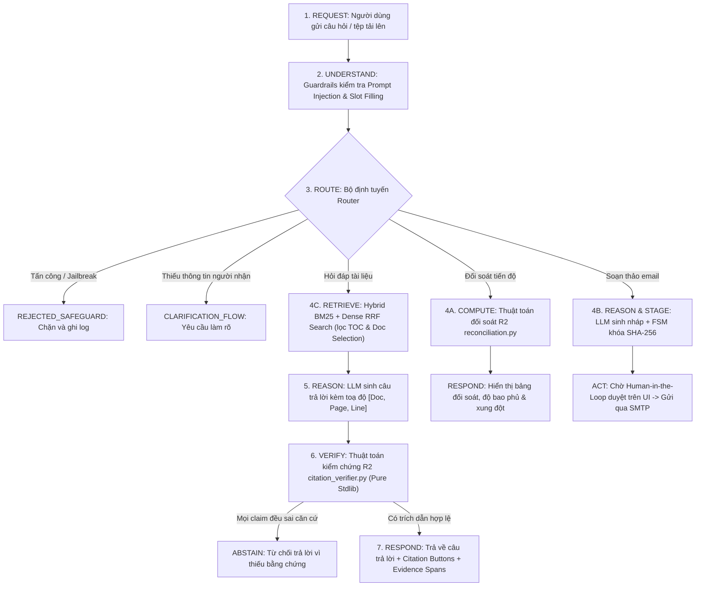

# BÁO CÁO TOÀN DIỆN KIẾN TRÚC VÀ HIỆN TRẠNG DỰ ÁN WORKSPACEAI
**Môn học:** CSC10014 – Computational Thinking (Tư duy Tính toán)  
**Khoa Công nghệ Thông tin – Trường Đại học Khoa học Tự nhiên, ĐHQG-HCM (FIT@HCMUS)**  
**Chủ đề (Track):** Track C – Intelligent Document Workspace  
**Ngày cập nhật:** 02/11/2026  
**Trạng thái kiểm thử:** 13/13 tests PASSED (100%)  

---

## MỤC LỤC
1. [Tổng quan dự án & Nguyên lý cốt lõi](#1-tổng-quan-dự-án--nguyên-lý-cốt-lõi)
2. [Hiện trạng tiến độ triển khai (Project Progress)](#2-hiện-trạng-tiến-độ-triển-khai-project-progress)
3. [Cấu trúc cây thư mục toàn diện (Project Directory Tree)](#3-cấu-trúc-cây-thư-mục-toàn-diện-project-directory-tree)
4. [Chức năng chi tiết của từng thư mục](#4-chức-năng-chi-tiết-của-từng-thư-mục)
5. [Chức năng chi tiết của từng tệp mã nguồn](#5-chức-năng-chi-tiết-của-từng-tệp-mã-nguồn)
6. [Đặc tả luồng xử lý phân tầng CSC10014 Pipeline](#6-đặc-tả-luồng-xử-lý-phân-tầng-csc10014-pipeline)
7. [Báo cáo kết quả kiểm thử (Test Suite Report)](#7-báo-cáo-kết-quả-kiểm-thử-test-suite-report)
8. [Hướng dẫn cấu hình và thực thi hệ thống](#8-hướng-dẫn-cấu-hình-và-thực-thi-hệ-thống)

---

## 1. TỔNG QUAN DỰ ÁN & NGUYÊN LÝ CỐT LÕI

WorkspaceAI là một **Trợ lý Không gian Làm việc Thông minh (Intelligent Document Workspace)** được xây dựng nhằm hỗ trợ các nhóm sinh viên và giảng viên quản lý đồ án học thuật:
- **Tra cứu tài liệu có trích dẫn đã kiểm chứng:** Hỏi đáp đa lượt dựa trên tài liệu PDF/TXT kèm toạ độ trang và dòng `[Doc, Page, Line]`.
- **Soi chiếu bằng chứng trực quan:** Tích hợp Evidence Viewer đồng bộ highlight đoạn văn bản gốc trong tài liệu.
- **Đối soát tiến độ tự động:** Đối chiếu đề bài môn học với bảng công việc thực tế, phát hiện xung đột ngày và trễ hạn.
- **Soạn thảo email có xác thực Human-in-the-Loop:** Tự động tạo bản nháp email báo cáo tiến độ, khóa tính toàn vẹn bằng SHA-256 và chỉ gửi đi khi người dùng phê duyệt trực tiếp.

### 5 Nguyên lý Kiến trúc Cốt lõi (Core Architecture Principles)
1. **AI là một thành phần tính toán, không phải là toàn bộ kiến trúc:** LLM không nắm quyền điều phối hệ thống mà được kiểm soát bởi bộ định tuyến tất định (Deterministic Router).
2. **Không mặc định tin tưởng đầu ra của LLM:** Mọi thông tin do AI sinh ra phải vượt qua tầng kiểm chứng trích lục (Citation Verifier) trước khi hiển thị cho người dùng.
3. **Thuật toán tất định (R2 Algorithms) độc lập 100%:** Các thuật toán cốt lõi (`citation_verifier.py`, `reconciliation.py`, `email_state_machine.py`) viết hoàn toàn bằng Python tiêu chuẩn (`stdlib`), không phụ thuộc vào Pydantic, FastAPI, hay bất kỳ thư viện bên ngoài nào.
4. **Mọi khẳng định đều phải truy xuất được nguồn gốc (Full Traceability):** Từng luận điểm phải kèm toạ độ `doc_id`, `page`, `start_line`, `end_line`, `doc_version`, `doc_hash`.
5. **Cổng kiểm soát con người (Human-in-the-Loop):** Không tự ý gửi email, không tự ý tạo công việc chính thức nếu chưa có cờ xác nhận `user_confirmed = True`.

---

## 2. HIỆN TRẠNG TIẾN ĐỘ TRIỂN KHAI (PROJECT PROGRESS)

Hệ thống hiện tại đã hoàn thiện toàn bộ **3 Feature cốt lõi** và tầng bảo vệ an toàn theo đặc tả đề bài:

| Thành phần | Đặc tả kỹ thuật | Trạng thái | Chi tiết triển khai |
| :--- | :--- | :---: | :--- |
| **Feature 1** | **Evidence-Grounded Q&A** | ✅ **HOÀN TẤT 100%** | Ingestion phân trang/dòng; SHA-256 versioning; Hybrid BM25 + Dense RRF Search; Lọc TOC; Prompt Grounding; Decoupled Citation Verifier (Exact + Token-LCS); Layout 3 Panel UI + Evidence Viewer. |
| **Feature 2** | **Cross-Document Reconciliation** | ✅ **HOÀN TẤT 100%** | Thuật toán đối soát tất định thuần Python (`reconciliation.py`); Đối chiếu ngày, hạn chót, người phụ trách, tính tỷ lệ bao phủ yêu cầu; Giao diện Taskboard & Ribbon thanh tiến độ. |
| **Feature 3** | **Context-Aware Email Assistant** | ✅ **HOÀN TẤT 100%** | Máy trạng thái FSM (`email_state_machine.py`); Khóa chống sửa đổi SHA-256; Dispatcher Gmail SMTP TLS (cổng 587); Hộp thoại duyệt email Human-in-the-Loop. |
| **R5 Router** | **Deterministic Orchestrator** | ✅ **HOÀN TẤT 100%** | Phân loại luồng dựa trên từ khóa và slot-filling; Phát hiện thiếu thông tin chuyển `CLARIFICATION_FLOW`. |
| **R7 Safeguard** | **Prompt Injection & Tamper Lock** | ✅ **HOÀN TẤT 100%** | Bộ lọc Regex phát hiện tấn công Prompt Injection/Jailbreak (`REJECTED_SAFEGUARD`); Chuẩn hóa RFC-5322 cho email. |
| **Test Suite** | **Kiểm thử tự động** | ✅ **13/13 PASS** | 8 test cases chuyên sâu cho Feature 1 + 5 test cases end-to-end cho toàn bộ pipeline. |

---

## 3. CẤU TRÚC CÂY THƯ MỤC TOÀN DIỆN (PROJECT DIRECTORY TREE)

```text
WorkspaceAI_Local_Skeleton/
│
├── .env                                        # Biến môi trường hệ thống (LLM provider, Ollama, Gemini, SMTP)
├── .env.example                                # Bản mẫu biến môi trường
├── .gitignore                                  # Cấu hình bỏ qua tệp git
├── AGENTS.md                                   # Hướng dẫn quy tắc cho AI coding agent
├── pytest.ini                                  # Cấu hình kiểm thử Pytest
├── README.md                                   # Hướng dẫn giới thiệu dự án
├── requirements.txt                            # Danh mục thư viện Python phụ thuộc
│
├── .skills/                                    # Bộ quy chuẩn kiến trúc và kỹ năng phát triển
│   ├── architecture_guard.md                   # Quy tắc bảo vệ kiến trúc phân tầng CSC10014
│   ├── backendFastAPISkill.md                  # Quy tắc lập trình backend FastAPI, schemas, services
│   └── frontendReactSkill.md                   # Quy tắc lập trình frontend và design tokens
│
├── .streamlit/                                 # Cấu hình giao diện Streamlit
│   └── config.toml                             # Thiết lập theme bảng màu chuẩn (light, primary #0E4A5A)
│
├── backend/                                    # Toàn bộ mã nguồn phía máy chủ (Backend Core & APIs)
│   ├── __init__.py                             # Đánh dấu package backend
│   ├── main.py                                 # Điểm khởi chạy ứng dụng FastAPI & đăng ký router
│   ├── Retrieval_R3.py                         # Stub chuyển tiếp tương thích ngược cho retrieval
│   │
│   ├── algorithms/                             # THUẬT TOÁN R2 (100% Pure Python Standard Library)
│   │   ├── __init__.py                         # Cơ chế lazy import (__getattr__) bảo toàn stdlib purity
│   │   ├── citation_verifier.py                # Thuật toán đối soát trích dẫn: Exact match, Token-LCS, Fuzzy
│   │   ├── email_state_machine.py              # Máy trạng thái hữu hạn (FSM) và khóa băm SHA-256 bản nháp
│   │   └── reconciliation.py                   # Thuật toán đối soát chéo đề bài vs bảng công việc
│   │
│   ├── api/                                    # TẦNG REST API (FastAPI Routers)
│   │   ├── __init__.py                         # Export các router
│   │   ├── chat_routes.py                      # Endpoint chính /api/chat (Router & Orchestration)
│   │   ├── document_routes.py                  # Endpoints CRUD /api/documents (Upload, List, Select, Delete)
│   │   └── email_routes.py                     # Endpoint phê duyệt gửi email /api/email/approve/{id}
│   │
│   ├── core/                                   # TẦNG CỐT LÕI (Configuration, Schemas, Safeguards)
│   │   ├── __init__.py                         # Core package exports
│   │   ├── config.py                           # Dataclass quản lý cấu hình tập trung từ .env
│   │   ├── guardrails.py                       # Bộ lọc Prompt-Injection (R7) & kiểm tra định dạng email
│   │   └── schemas.py                          # Khai báo dữ liệu Pydantic (UserRequest, TaskRecord, Claims...)
│   │
│   ├── providers/                              # TẦNG TÍCH HỢP MÔ HÌNH BÊN NGOÀI (LLM & Embeddings)
│   │   ├── __init__.py                         # Provider package exports
│   │   ├── embedding_provider.py               # Local Dense Embedding đa ngữ (SentenceTransformers lazy load)
│   │   └── llm_provider.py                     # Bộ điều phối LLM (Ollama, Gemini, Offline Smart Synthesizer)
│   │
│   ├── repositories/                           # TẦNG LƯU TRỮ VÀ LẬP CHỈ MỤC DỮ LIỆU
│   │   ├── __init__.py                         # Repository package exports
│   │   ├── draft_repository.py                 # Lưu trữ bản nháp email trong bộ nhớ
│   │   └── workspace_repository.py             # Chỉ mục tài liệu, BM25Okapi, RRF ranking, TOC penalty
│   │
│   └── services/                               # TẦNG NGHIỆP VỤ HỆ THỐNG (Service Layer)
│       ├── __init__.py                         # Services package exports
│       ├── document_service.py                 # Xử lý nạp tệp (PDF/TXT/CSV), locator dòng/trang, SHA-256 versioning
│       ├── email_service.py                    # Nghiệp vụ tạo nháp, gắn trích dẫn, gửi Gmail SMTP thực
│       ├── qa_service.py                       # Nghiệp vụ hỏi đáp: mở rộng ngữ cảnh, lọc nguồn, kiểm chứng R2
│       ├── reconciliation_service.py           # Nghiệp vụ cầu nối dữ liệu cho thuật toán đối soát tiến độ
│       └── router_service.py                   # Phân loại luồng (QA, Reconcile, Email, Clarify, Safeguard)
│
├── frontend/                                   # Giao diện người dùng Web
│   └── app.py                                  # Giao diện Streamlit 3 Panel (Library | Chat Q&A | Evidence Viewer)
│
├── tests/                                      # Bộ kiểm thử tự động toàn diện
│   ├── test_feature1_grounded_qa.py            # 8 bài kiểm thử chuyên sâu cho Feature 1 & Stdlib isolation
│   └── test_r2_r7_pipeline.py                  # 5 bài kiểm thử tích hợp toàn bộ pipeline R2 - R7
│
└── Computational Thinking Report/              # Hồ sơ báo cáo kỹ thuật học thuật của đồ án
    └── Computational Thinking Report/
        ├── book/                               # Mã nguồn báo cáo định dạng LaTeX (Chapters 1-7)
        ├── readme.md                           # Hướng dẫn biên dịch LaTeX
        └── ...
```

---

## 4. CHỨC NĂNG CHI TIẾT CỦA TỪNG THƯ MỤC

### 1. `backend/algorithms/`
- **Mục đích:** Chứa toàn bộ các thuật toán cốt lõi thuộc nhóm năng lực **R2 (Deterministic Capability)**.
- **Quy tắc bất biến:** Phải viết bằng **100% Python thuần (`standard library`)**, tuyệt đối không import các thư viện bên ngoài như `pydantic`, `fastapi`, `numpy`, hay gọi mạng. Đảm bảo tính tất định, độc lập hoàn toàn với AI.

### 2. `backend/api/`
- **Mục đích:** Cung cấp các giao diện lập trình ứng dụng RESTful (HTTP Endpoints) sử dụng FastAPI.
- **Vai trò:** Tiếp nhận request từ client (Frontend Streamlit hoặc các ứng dụng khác), chuyển dữ liệu vào Service layer và trả về JSON payload chuẩn hóa.

### 3. `backend/core/`
- **Mục đích:** Lưu trữ các cấu trúc dữ liệu nền tảng dùng chung trong toàn bộ hệ thống.
- **Vai trò:** Bao gồm việc nạp biến môi trường (`config.py`), định nghĩa các lớp đối tượng dữ liệu Pydantic (`schemas.py`), và các bộ quy tắc cổng an toàn Safeguard (`guardrails.py`).

### 4. `backend/providers/`
- **Mục đích:** Đóng gói (Encapsulate) các kết nối tới các mô hình AI bên ngoài.
- **Vai trò:** Quản lý kết nối tới Ollama local, Google Gemini cloud, nạp mô hình nhúng vector ngữ nghĩa (SentenceTransformers), và dự phòng bộ tổng hợp ngoại tuyến (Offline Synthesizer).

### 5. `backend/repositories/`
- **Mục đích:** Đảm nhiệm vai trò tầng truy xuất dữ liệu (Data Access Layer / In-memory Store).
- **Vai trò:** Quản lý danh sách các đoạn trích (`DocumentChunk`), tài liệu (`DocumentMetadata`), duy trì chỉ mục từ khóa `BM25Okapi`, thực hiện thuật toán xếp hạng hợp nhất `RRF`, và lưu trữ bản nháp email.

### 6. `backend/services/`
- **Mục đích:** Tầng nghiệp vụ trung tâm (Business Logic Layer).
- **Vai trò:** Kết nối các thành phần: nhận dữ liệu từ API $\rightarrow$ gọi Repository để tìm kiếm/tính toán $\rightarrow$ chuyển ngữ cảnh cho Provider sinh phản hồi $\rightarrow$ chuyển qua Algorithm để đối soát/kiểm chứng $\rightarrow$ trả kết quả xác thực.

### 7. `frontend/`
- **Mục đích:** Giao diện đồ họa người dùng tương tác trực quan (Web User Interface).
- **Vai trò:** Xây dựng trên nền tảng Streamlit, triển khai bố cục 3 Panel công thái học giúp người dùng tải tài liệu, hỏi đáp có trích dẫn, và soi chiếu bằng chứng gốc một cách dễ dàng.

### 8. `tests/`
- **Mục đích:** Môi trường kiểm thử tự động (Automated Test Suite) sử dụng `pytest` và `unittest`.
- **Vai trò:** Kiểm tra tính toàn vẹn của thuật toán, kiểm tra sự cô lập thư viện tiêu chuẩn, kiểm tra các luồng API, và đảm bảo không có lỗi hồi quy (regression) khi nâng cấp hệ thống.

---

## 5. CHỨC NĂNG CHI TIẾT CỦA TỪNG TỆP MÃ NGUỒN

### Nhóm 1: Backend Core & Config

#### [`backend/core/config.py`](file:///d:/NAM2_HK1_HCMUS/TDTT/WorkspaceAI_Local_Skeleton/WorkspaceAI_Local_Skeleton/backend/core/config.py)
- Nạp cấu hình từ file `.env` qua `dataclass Settings`.
- Thiết lập nhà cung cấp LLM (`mock`, `ollama`, `gemini`), URL và model Ollama (`qwen2.5:3b`), ngưỡng liên quan truy xuất `dense_tau_rel` ($0.35$), `bm25_tau_rel` ($0.35$), ngưỡng so khớp trích dẫn `theta_match` ($0.75$), và thông số SMTP Gmail (cổng $587$).

#### [`backend/core/schemas.py`](file:///d:/NAM2_HK1_HCMUS/TDTT/WorkspaceAI_Local_Skeleton/WorkspaceAI_Local_Skeleton/backend/core/schemas.py)
- Khai báo các mô hình dữ liệu Pydantic trao đổi trong hệ thống:
  - `UserRequest`: Request người dùng kèm query, `selected_doc_ids`, `conversation_history`.
  - `DocumentChunk`: Phân đoạn tài liệu kèm toạ độ `page_number`, `start_line`, `end_line`, `doc_version`, `doc_hash`, điểm số BM25/Dense/RRF.
  - `DocumentMetadata`: Metadata tài liệu (hash SHA-256, số trang, số dòng, phiên bản).
  - `GeneratedClaim`: Luận điểm trích dẫn kèm `evidence_span` và trạng thái xác thực.
  - `TaskRecord`, `EmailDraftPayload`, `RouteType`, `EmailState`.

#### [`backend/core/guardrails.py`](file:///d:/NAM2_HK1_HCMUS/TDTT/WorkspaceAI_Local_Skeleton/WorkspaceAI_Local_Skeleton/backend/core/guardrails.py)
- Triển khai năng lực an toàn **R7**:
  - `detect_prompt_injection(query)`: Nhận diện các mẫu tấn công vượt quyền (Jailbreak, bypass instruction).
  - `validate_email_address(email)`: Xác thực email theo chuẩn RFC-5322.
  - `wrap_untrusted_chunk(...)`: Bao bọc văn bản tài liệu bằng thẻ an toàn XML `<untrusted_document_data>` kèm toạ độ dòng/trang để chống tấn công gián tiếp qua tài liệu (Indirect Prompt Injection).

---

### Nhóm 2: Thuật toán R2 (Pure Python Standard Library)

#### [`backend/algorithms/citation_verifier.py`](file:///d:/NAM2_HK1_HCMUS/TDTT/WorkspaceAI_Local_Skeleton/WorkspaceAI_Local_Skeleton/backend/algorithms/citation_verifier.py)
- **Nhiệm vụ:** Kiểm chứng trích dẫn độc lập, không dùng AI, đảm bảo 100% tất định.
- **Quy trình 5 bước xác thực:**
  1. Kiểm tra sự tồn tại của `doc_id` trong hệ thống (nếu sai $\rightarrow$ `INVALID_DOC_ID`).
  2. Kiểm tra trang `cited_page` có tồn tại trong tài liệu (nếu sai $\rightarrow$ `INVALID_SOURCE_PAGE`).
  3. Kiểm tra toạ độ dòng `start_line` và `end_line` có nằm trong giới hạn trang (nếu sai $\rightarrow$ `LINE_OUT_OF_RANGE`).
  4. Kiểm tra mã hash SHA-256 và phiên bản tài liệu có khớp với dữ liệu gốc (nếu sai $\rightarrow$ `HASH_MISMATCH` / `VERSION_MISMATCH`).
  5. Đối soát nội dung đoạn trích (`evidence_quote`):
     - Bước 5A: So khớp chuỗi con chuẩn hoá chính xác 100% $\rightarrow$ `VERIFIED_EXACT` ($1.0$).
     - Bước 5B: So khớp quy hoạch động **Token-LCS** (Longest Common Subsequence) cho phép sai lệch trật tự nhỏ $\rightarrow$ `VERIFIED_FUZZY` ($score \ge \theta$).
     - Bước 5C: Fallback Token Overlap Ratio. Nếu không đạt ngưỡng $\rightarrow$ `UNGROUNDED_QUOTE`.

#### [`backend/algorithms/email_state_machine.py`](file:///d:/NAM2_HK1_HCMUS/TDTT/WorkspaceAI_Local_Skeleton/WorkspaceAI_Local_Skeleton/backend/algorithms/email_state_machine.py)
- **Nhiệm vụ:** Quản lý máy trạng thái hữu hạn cho quy trình gửi email an toàn.
- Chuyển dịch trạng thái nghiêm ngặt: `IDLE` $\rightarrow$ `PENDING_APPROVAL` $\rightarrow$ `APPROVED` $\rightarrow$ `SENT`.
- `compute_draft_hash(...)`: Sinh mã băm SHA-256 từ `recipient|subject|body|attachments`.
- `approve_and_verify_email_send(...)`: Bắt buộc cờ `user_confirmed == True` và kiểm tra hash trước khi duyệt; nếu phát hiện bị can thiệp ngầm sẽ bắn lỗi `SecurityError`.

#### [`backend/algorithms/reconciliation.py`](file:///d:/NAM2_HK1_HCMUS/TDTT/WorkspaceAI_Local_Skeleton/WorkspaceAI_Local_Skeleton/backend/algorithms/reconciliation.py)
- **Nhiệm vụ:** Đối soát chéo giữa danh mục yêu cầu trong đề bài (`requirements`) và bảng phân công công việc (`tasks`).
- Xác định trạng thái của từng yêu cầu: `COMPLETED`, `IN_PROGRESS_ON_TIME`, `OVERDUE`, `UNTRACKED_MISSING`, `CONFLICTING_DATE`.
- Tính toán tỷ lệ bao phủ yêu cầu (`coverage_ratio`), tổng số công việc trễ hạn, và danh sách các xung đột ngày nộp bài giữa các tài liệu.

#### [`backend/algorithms/__init__.py`](file:///d:/NAM2_HK1_HCMUS/TDTT/WorkspaceAI_Local_Skeleton/WorkspaceAI_Local_Skeleton/backend/algorithms/__init__.py)
- Sử dụng hàm điều phối `__getattr__` để nạp động (lazy loading) các thuật toán R2, ngăn chặn việc nạp trước các module có chứa Pydantic/FastAPI, bảo vệ sự thuần khiết tuyệt đối của `sys.modules`.

---

### Nhóm 3: Providers & Repositories

#### [`backend/providers/embedding_provider.py`](file:///d:/NAM2_HK1_HCMUS/TDTT/WorkspaceAI_Local_Skeleton/WorkspaceAI_Local_Skeleton/backend/providers/embedding_provider.py)
- Nạp lazy mô hình nhúng cục bộ `paraphrase-multilingual-MiniLM-L12-v2`.
- Mã hóa văn bản thành vector numpy chuẩn hóa độ dài đơn vị (unit-norm).
- Cơ chế Graceful Fallback: Bắt toàn bộ ngoại lệ khi máy không có thư viện hoặc không tải được model, tự động gán `is_available = False` để hệ thống chạy BM25 mà không bị crash.

#### [`backend/providers/llm_provider.py`](file:///d:/NAM2_HK1_HCMUS/TDTT/WorkspaceAI_Local_Skeleton/WorkspaceAI_Local_Skeleton/backend/providers/llm_provider.py)
- Tích hợp 3 chế độ LLM: Ollama (Qwen 2.5), Gemini API, và Smart Offline Synthesizer.
- `generate_grounded_qa(...)`: Đưa ngữ cảnh tài liệu kèm lịch sử 4 lượt hội thoại gần nhất vào prompt, ép buộc sinh câu trả lời kèm trích dẫn `[Tên tài liệu, Trang X, Dòng Y-Z]`.
- `generate_summary(...)`: Tạo bản tóm tắt cấu trúc tổng quan từ toàn bộ các trang của tài liệu.
- `generate_email_draft(...)`: Soạn tiêu đề và nội dung email báo cáo theo ngữ cảnh.

#### [`backend/repositories/workspace_repository.py`](file:///d:/NAM2_HK1_HCMUS/TDTT/WorkspaceAI_Local_Skeleton/WorkspaceAI_Local_Skeleton/backend/repositories/workspace_repository.py)
- Lưu trữ danh sách phân đoạn văn bản (`chunks`) và metadata tài liệu (`documents`).
- Xây dựng chỉ mục từ khóa `BM25Okapi`.
- **Hybrid Retrieval & RRF Fusion:**
  - Nhánh Lexical: Tính điểm BM25 kết hợp Token-Overlap tie-breaker.
  - Nhánh Dense: Tính Cosine Similarity vector nếu embedding provider khả dụng.
  - Hợp nhất xếp hạng RRF: $RRF(d) = \sum_{m \in \{BM25, Dense\}} \frac{1}{60 + \text{rank}_m(d)}$.
  - **TOC Penalty:** Tự động hạ điểm $85\%$ đối với các trang Mục lục / List of Figures khi câu hỏi người dùng mang tính chất tìm kiếm nội dung giải thích.
  - **Selection Enforcement:** Giới hạn phạm vi tìm kiếm theo `selected_doc_ids` (nếu `[]` lập tức trả về rỗng).

#### [`backend/repositories/draft_repository.py`](file:///d:/NAM2_HK1_HCMUS/TDTT/WorkspaceAI_Local_Skeleton/WorkspaceAI_Local_Skeleton/backend/repositories/draft_repository.py)
- Lưu trữ các bản nháp email (`EmailDraftPayload`) trong bộ nhớ, phục vụ tra cứu và kiểm tra FSM.

---

### Nhóm 4: Services Layer

#### [`backend/services/document_service.py`](file:///d:/NAM2_HK1_HCMUS/TDTT/WorkspaceAI_Local_Skeleton/WorkspaceAI_Local_Skeleton/backend/services/document_service.py)
- Bóc tách văn bản từ tệp PDF (dùng `pypdf`), TXT, CSV.
- **Từ chối PDF dạng ảnh:** Ném ngoại lệ `ValueError` nếu phát hiện file PDF scan không có lớp ký tự text layer.
- **Đánh chỉ mục dòng:** Phân tách đoạn văn bản giới hạn trong từng trang duy nhất, đánh toạ độ dòng `start_line` và `end_line` (1-based index).
- **Tính toán SHA-256 & Quản lý phiên bản:** Kiểm tra trùng lặp nội dung (`ALREADY_EXISTS`), nếu cùng tên khác hash sẽ tự động tăng phiên bản `v1` $\rightarrow$ `v2`.

#### [`backend/services/qa_service.py`](file:///d:/NAM2_HK1_HCMUS/TDTT/WorkspaceAI_Local_Skeleton/WorkspaceAI_Local_Skeleton/backend/services/qa_service.py)
- **Deterministic Contextual Query Expansion:** Tự động ghép nối câu hỏi liền trước trong lịch sử nếu câu hỏi hiện tại ngắn ($\le 4$ từ) hoặc có đại từ thay thế (`nó`, `đó`, `it`, v.v.).
- **Cổng Abstain tuyệt đối:** Kiểm tra ngưỡng điểm tuyệt đối (Cosine similarity hoặc Normalized BM25), không dùng điểm RRF cho cổng từ chối.
- Giao tiếp với thuật toán R2 `verify_citations` thông qua các Adapter chuyển đổi hai chiều (`claim_schema_to_algorithm`, `verification_result_to_schema`).
- Trả về toạ độ `evidence_span` chi tiết cho từng trích dẫn hợp lệ.

#### [`backend/services/reconciliation_service.py`](file:///d:/NAM2_HK1_HCMUS/TDTT/WorkspaceAI_Local_Skeleton/WorkspaceAI_Local_Skeleton/backend/services/reconciliation_service.py)
- Cung cấp dữ liệu yêu cầu mẫu (`Project_Brief.pdf`) và công việc mẫu (`team_tasks.csv`).
- Thực hiện gọi thuật toán `reconcile_requirements_and_tasks` với ngày đối soát `reference_date`.

#### [`backend/services/email_service.py`](file:///d:/NAM2_HK1_HCMUS/TDTT/WorkspaceAI_Local_Skeleton/WorkspaceAI_Local_Skeleton/backend/services/email_service.py)
- Sinh bản nháp email theo ngữ cảnh truy xuất từ tài liệu workspace.
- Gửi email thực qua giao thức Gmail SMTP TLS (cổng 587) thông qua hàm `send_real_email_via_smtp`.

#### [`backend/services/router_service.py`](file:///d:/NAM2_HK1_HCMUS/TDTT/WorkspaceAI_Local_Skeleton/WorkspaceAI_Local_Skeleton/backend/services/router_service.py)
- Kiểm tra cổng an toàn `detect_prompt_injection` $\rightarrow$ `REJECTED_SAFEGUARD`.
- Kiểm tra tính đầy đủ thông tin (Slot filling), nếu thiếu email khi muốn gửi thư $\rightarrow$ `CLARIFICATION_FLOW`.
- Phân luồng tất định: `EMAIL_FLOW`, `RECONCILE_FLOW`, `QA_FLOW`.

---

### Nhóm 5: Tầng Giao tiếp API & Giao diện Người dùng

#### [`backend/api/chat_routes.py`](file:///d:/NAM2_HK1_HCMUS/TDTT/WorkspaceAI_Local_Skeleton/WorkspaceAI_Local_Skeleton/backend/api/chat_routes.py)
- Endpoint `POST /api/chat`: Điểm tiếp nhận chính của toàn bộ hệ thống, gọi `route_user_request` và điều hướng sang các dịch vụ tương ứng.

#### [`backend/api/document_routes.py`](file:///d:/NAM2_HK1_HCMUS/TDTT/WorkspaceAI_Local_Skeleton/WorkspaceAI_Local_Skeleton/backend/api/document_routes.py)
- Cung cấp toàn bộ các API quản lý thư viện tài liệu:
  - `GET /api/documents`: Lấy danh sách metadata.
  - `POST /api/documents/upload`: Tải lên và bóc tách tài liệu.
  - `POST /api/documents/select`: Đặt các tài liệu được kích hoạt tra cứu.
  - `DELETE /api/documents/{doc_id}`: Xóa tài liệu khỏi hệ thống.

#### [`backend/api/email_routes.py`](file:///d:/NAM2_HK1_HCMUS/TDTT/WorkspaceAI_Local_Skeleton/WorkspaceAI_Local_Skeleton/backend/api/email_routes.py)
- Endpoint `POST /api/email/approve/{draft_id}`: Xác thực tính toàn vẹn và thực hiện gửi email khi có phê duyệt của con người.

#### [`backend/main.py`](file:///d:/NAM2_HK1_HCMUS/TDTT/WorkspaceAI_Local_Skeleton/WorkspaceAI_Local_Skeleton/backend/main.py)
- Khởi tạo ứng dụng FastAPI với `lifespan` tự động seed dữ liệu mẫu đồ án `Project_Brief.pdf` và `team_tasks.csv`. Đăng ký 3 router: `chat_router`, `email_router`, `document_router`.

#### [`frontend/app.py`](file:///d:/NAM2_HK1_HCMUS/TDTT/WorkspaceAI_Local_Skeleton/WorkspaceAI_Local_Skeleton/frontend/app.py)
- Ứng dụng Streamlit với thiết kế 3 Panel trực quan:
  - **Panel 1 (Trái):** Thư viện tài liệu (Upload, chọn/bỏ chọn nguồn, xóa, tóm tắt nhanh, xem thông số SHA-256 và phiên bản).
  - **Panel 2 (Giữa):** Khung chat tương tác đa lượt, hiển thị câu trả lời với các nút bấm trích dẫn `📄 [Tên tài liệu, Trang X, Dòng Y-Z]`.
  - **Panel 3 (Phải):**
    - *Tab 1 (Soi bằng chứng):* Khi bấm vào nút trích dẫn ở Panel 2, khung này lập tức hiện trang văn bản gốc với đoạn trích được tô sáng màu vàng cùng toạ độ xác thực.
    - *Tab 2 (Bảng công việc):* Bảng tiến độ công việc, ribbon trạng thái hoàn thành và form thêm công việc mới.
    - *Tab 3 (Email):* Trình xem, chỉnh sửa và nút phê duyệt gửi email báo cáo.

---

## 6. ĐẶC TẢ LUỒNG XỬ LÝ PHÂN TẦNG CSC10014 PIPELINE

Toàn bộ hệ thống vận hành tuân thủ chặt chẽ chuỗi xử lý chuẩn của môn học:

$$\text{REQUEST} \longrightarrow \text{UNDERSTAND} \longrightarrow \text{ROUTE} \longrightarrow \text{RETRIEVE / COMPUTE} \longrightarrow \text{REASON} \longrightarrow \text{VERIFY} \longrightarrow \text{RESPOND / ACT}$$



---

## 7. BÁO CÁO KẾT QUẢ KIỂM THỬ (TEST SUITE REPORT)

Toàn bộ test suite được thực thi bằng lệnh `pytest -v`. Kết quả đạt **13/13 tests PASSED (100%)**:

```text
============================= test session starts =============================
platform win32 -- Python 3.14.5, pytest-8.3.3, pluggy-1.6.0
rootdir: D:\NAM2_HK1_HCMUS\TDTT\WorkspaceAI_Local_Skeleton\WorkspaceAI_Local_Skeleton
configfile: pytest.ini
collected 13 items

tests/test_feature1_grounded_qa.py::TestFeature1GroundedQA::test_01_pure_stdlib_isolation PASSED [  7%]
tests/test_feature1_grounded_qa.py::TestFeature1GroundedQA::test_02_citation_verifier_matching_modes PASSED [ 15%]
tests/test_feature1_grounded_qa.py::TestFeature1GroundedQA::test_03_citation_verifier_boundaries_and_hashes PASSED [ 23%]
tests/test_feature1_grounded_qa.py::TestFeature1GroundedQA::test_04_selected_doc_ids_retrieval_filtering PASSED [ 30%]
tests/test_feature1_grounded_qa.py::TestFeature1GroundedQA::test_05_contextual_query_expansion PASSED [ 38%]
tests/test_feature1_grounded_qa.py::TestFeature1GroundedQA::test_06_hybrid_rrf_scoring_and_fallback PASSED [ 46%]
tests/test_feature1_grounded_qa.py::TestFeature1GroundedQA::test_07_document_service_ingestion_and_scanned_pdf PASSED [ 53%]
tests/test_feature1_grounded_qa.py::TestFeature1GroundedQA::test_08_rest_api_document_endpoints PASSED [ 61%]
tests/test_r2_r7_pipeline.py::TestWorkspaceAIPipeline::test_algorithm_1_cross_document_reconciliation PASSED [ 69%]
tests/test_r2_r7_pipeline.py::TestWorkspaceAIPipeline::test_algorithm_2_citation_verifier PASSED [ 76%]
tests/test_r2_r7_pipeline.py::TestWorkspaceAIPipeline::test_algorithm_3_email_fsm_and_tamper_protection PASSED [ 84%]
tests/test_r2_r7_pipeline.py::TestWorkspaceAIPipeline::test_api_endpoints_and_services PASSED [ 92%]
tests/test_r2_r7_pipeline.py::TestWorkspaceAIPipeline::test_r5_clarification_and_r7_injection_routing PASSED [100%]

======================== 13 passed, 1 warning in 1.12s ========================
```

---

## 8. HƯỚNG DẪN CẤU HÌNH VÀ THỰC THI HỆ THỐNG

### 1. Cài đặt môi trường phụ thuộc
```powershell
pip install -r requirements.txt
```

### 2. Khởi chạy Backend FastAPI
```powershell
uvicorn backend.main:app --reload --port 8000
```
Tài liệu tương tác Swagger UI sẽ khả dụng tại: `http://localhost:8000/docs`.

### 3. Khởi chạy Giao diện Frontend Streamlit
```powershell
streamlit run frontend/app.py
```
Ứng dụng sẽ tự động mở trên trình duyệt tại địa chỉ: `http://localhost:8501`.

### 4. Kết nối Mô hình AI (Tùy chọn)
- **Chế độ Offline (Mặc định):** Sử dụng bộ tổng hợp động nội bộ, không cần cài thêm công cụ gì.
- **Chế độ Ollama (Local LLM):**
  1. Cài đặt Ollama từ [ollama.com](https://ollama.com).
  2. Kéo mô hình: `ollama pull qwen2.5:3b`.
  3. Đảm bảo file `.env` có cấu hình `OLLAMA_MODEL=qwen2.5:3b`.
- **Chế độ Gemini (Cloud LLM):**
  1. Lấy API key miễn phí từ [Google AI Studio](https://aistudio.google.com).
  2. Nhập API key vào ô cấu hình ở thanh Sidebar bên trái của giao diện Streamlit.
