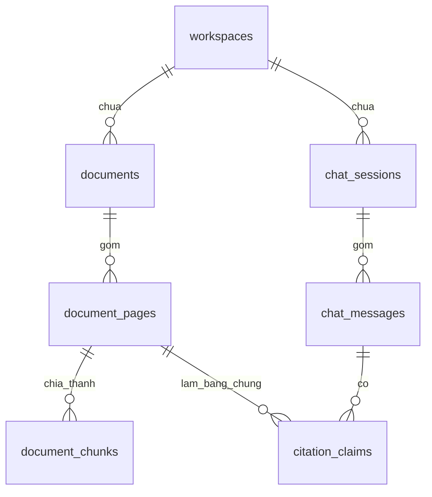

# Thiết kế cơ sở dữ liệu WorkspaceAI

## Hiện trạng

[Schema MySQL](schema.sql) tạo 11 bảng cho tài khoản, notebook, tài liệu, hội thoại, trích dẫn và email. [Compose cho database](compose.yml) khởi tạo schema trên volume mới. Xem [lệnh khởi động MySQL](../README.md#mysql-database).

Ứng dụng vẫn lưu metadata, đoạn văn bản và embedding (nếu có) vào `.workspace_data/libraries/{workspace_id}.json`. Frontend lưu notebook, hội thoại và dữ liệu giao diện bằng `localStorage`. Phiên luyện tập và bản nháp phía backend được giữ trong bộ nhớ tiến trình. Các bước chuyển dữ liệu sang MySQL được mô tả ở phần cuối.

## MVP cho thư viện và hỏi đáp có trích dẫn

| Bảng | Trường chính | Ý nghĩa và mức độ cần thiết |
| --- | --- | --- |
| `workspaces` | `workspace_id` (PK), `name`, `created_at`, `updated_at` | **Cốt lõi.** Xác định notebook sở hữu dữ liệu để hai notebook có thể dùng nguồn và lịch sử riêng. |
| `documents` | `workspace_id`, `doc_id`, `doc_name`, `file_type`, `file_hash`, `version_id`, `storage_path`, `source_url`, `uploaded_at`, `archived_at` | **Cốt lõi.** Một hàng nhận diện một bản nguồn đã nhập. `file_hash` nhận diện nội dung nhập để chống trùng trong cùng workspace. `storage_path` trỏ đến tệp gốc khi tệp được lưu. URL giữ địa chỉ nguồn, còn văn bản đã trích xuất giữ nội dung dùng làm bằng chứng tại thời điểm nhập. |
| `document_pages` | `page_id` (PK), `workspace_id`, `doc_id`, `page_number`, `raw_text`, `line_count` | **Cốt lõi cho kiểm chứng.** Lưu văn bản trích xuất theo đúng quy ước xuống dòng mà bộ xác minh sử dụng. Mỗi trang có một vị trí duy nhất trong bản nguồn. Với nguồn dạng web hoặc văn bản, trang có thể là đơn vị phân đoạn của parser. |
| `document_chunks` | `workspace_id`, `chunk_id`, `doc_id`, `page_number`, `start_line`, `end_line`, `text`, `section_header` | **Cốt lõi cho truy xuất.** Chia trang thành các đoạn có thể tìm kiếm. Đoạn tìm được phải dẫn về trang và khoảng dòng cụ thể để chatbot đối chiếu câu trích. |
| `chat_sessions` | `workspace_id`, `session_id`, `session_name`, `created_at`, `updated_at` | **Cần để lưu lịch sử.** Gom các lượt trao đổi theo hội thoại trong một notebook. Một notebook có thể khởi tạo với một phiên duy nhất. |
| `chat_messages` | `workspace_id`, `message_id`, `session_id`, `role`, `content`, `selected_docs`, `created_at` | **Cần để lưu lịch sử.** Lưu câu hỏi, câu trả lời và danh sách ID bản nguồn đã chọn tại lượt hỏi. `selected_docs` lưu danh sách dưới dạng JSON. Giữ `[]` để biểu thị người dùng đã bỏ chọn toàn bộ nguồn. |
| `citation_claims` | `workspace_id`, `claim_id`, `message_id`, `cited_doc_id`, `cited_page`, `cited_start_line`, `cited_end_line`, `claim_text`, `evidence_quote`, `verification_status`, `semantic_status` | **Cốt lõi cho lịch sử câu trả lời có nguồn.** Gắn nhận định của trợ lý với bản nguồn, trang và câu trích cụ thể. `verification_status` mô tả kết quả so khớp văn bản. `semantic_status` mô tả mức độ nguồn hỗ trợ nội dung nhận định, ví dụ `SUPPORTED` hoặc `INSUFFICIENT`. |

PK là khóa chính để định danh một hàng. FK là khóa ngoại để liên kết hàng với dữ liệu cha. Schema dùng `workspace_id` trong các khóa ghép để hai notebook có thể dùng cùng ID nguồn cục bộ và để khóa ngoại giữ tài liệu, hội thoại và trích dẫn trong đúng notebook.

Ví dụ, câu trả lời dẫn `Git.pdf, trang 26, dòng 92–93`. `citation_claims` giữ câu trích và khoảng dòng. `document_pages` giữ văn bản ở vị trí đó. Qua `documents`, hệ thống xác định đúng bản `Git.pdf` đã dùng để trả lời. Khi người dùng tải bản sửa, bản mới có `doc_id` riêng và trích dẫn cũ tiếp tục trỏ về bản cũ.

## Mở rộng theo tính năng

| Bảng hoặc thành phần | Dữ liệu và ý nghĩa | Khi cần |
| --- | --- | --- |
| `study_sets` | Bộ quiz hoặc flashcard đã lưu, gồm `workspace_id`, loại bộ, tiêu đề, nội dung có cấu trúc và tham chiếu tới bản nguồn. MVP có thể dùng JSON cho danh sách thẻ, câu hỏi và đáp án. | Khi cần mở lại bộ đã tạo sau khi khởi động lại hoặc đổi trình duyệt. Chuẩn hóa thành bảng thẻ/câu hỏi riêng khi cần sửa độc lập hoặc thống kê theo từng câu. |
| `study_attempts` | Lượt luyện tập, gồm `study_set_id`, người học, trạng thái, tiến độ hoặc câu trả lời đã nộp, điểm và thời gian. Gắn lượt làm với phiên bản bộ câu hỏi để có thể đọc lại kết quả khi bộ thay đổi. | Khi cần tiếp tục làm dở hoặc lưu lịch sử điểm. Backend giữ đáp án và chỉ trả theo đúng bước của luồng luyện tập. |
| `notes` | Ghi chú người dùng lưu, gồm `workspace_id`, tiêu đề, nội dung và tham chiếu tin nhắn hoặc bằng chứng nếu có. | Khi cần đồng bộ ghi chú qua backend. Có thể lưu chung với kết quả Studio nếu hai loại có cùng vòng đời và quyền truy cập. |
| `email_drafts` | Bản nháp, gồm `workspace_id`, người nhận, tiêu đề, nội dung, tệp đính kèm nếu có, trạng thái và hash của nội dung đã duyệt. Liên kết phiên chat nếu email xuất phát từ hội thoại. | Cần cho Feature 3 khi lưu bản nháp và duyệt qua nhiều lần mở ứng dụng. |
| `email_audit_logs` | Các lần tạo, duyệt, gửi và lỗi, gồm bản nháp, người thao tác, trạng thái trước/sau, kết quả và thời điểm. | Ưu tiên cao trước khi bật gửi thật. Nếu cần giữ nhật ký sau khi xóa nháp khỏi giao diện, dùng lưu trữ mềm và bảo vệ thao tác ghi nhật ký. |
| `users`, `workspace_members` | Tài khoản và quyền trong từng notebook. Xem [mô hình tài khoản](#tài-khoản-và-quyền-trong-notebook) bên dưới. | Cần khi triển khai đăng nhập hoặc vận hành nhiều người dùng. |
| Embedding và chỉ mục tìm kiếm | Vector theo đoạn hoặc hash nội dung đoạn, kèm ID encoder và kích thước vector. Tìm kiếm theo từ khóa và cosine có thể tiếp tục dùng logic Python hiện tại. | Lưu lại vector nếu cần giữ hiệu năng sau khởi động. Cân nhắc chỉ mục vector riêng khi phép đo truy xuất cho thấy cần. |
| Dàn ý và cache tóm tắt | Bookmark hoặc tiêu đề để định vị chương. Cache lưu kết quả có thể tính lại, gắn với hash hoặc bản nguồn và phiên bản bộ xử lý. | Giữ dàn ý đã trích xuất khi chuyển dữ liệu để bảo toàn hỏi đáp theo chương. Có thể lưu metadata dàn ý dưới dạng JSON. Cache tóm tắt có thể bổ sung sau. |

## Tài khoản và quyền trong notebook

`users` lưu mỗi tài khoản một lần. `workspace_members` cho biết tài khoản đó có quyền gì ở từng notebook. Một người có thể sở hữu nhiều notebook và tham gia notebook của người khác.

| Bảng | Trường | Ý nghĩa |
| --- | --- | --- |
| `users` | `user_id` (PK) | ID nội bộ cố định. Các bảng khác dùng ID này để liên kết ngay cả khi người dùng đổi email. |
| `users` | `email` (UNIQUE), `display_name`, `created_at` | Email dùng cho tài khoản, chuẩn hóa trước khi kiểm tra trùng. Tên hiển thị và ngày tạo giúp nhận diện tài khoản trong giao diện. |
| `users` | `password_hash`, `email_verified_at` | Dùng khi WorkspaceAI tự quản lý đăng nhập bằng email và mật khẩu. Lưu hash mật khẩu và thời điểm xác minh email. `password_hash` có thể để trống cho tài khoản chỉ đăng nhập qua nhà cung cấp. |
| `workspace_members` | `workspace_id` (FK), `user_id` (FK) | Hai trường tạo khóa chính ghép để mỗi người chỉ có một bản ghi quyền trong mỗi notebook. |
| `workspace_members` | `role`, `joined_at` | Lưu quyền và thời điểm tham gia. Đề xuất `owner` quản lý notebook và thành viên, `editor` chỉnh sửa nội dung, `viewer` chỉ xem nội dung được chia sẻ. |
| `auth_identities` | `user_id` (FK), `provider`, `provider_user_id` | Bổ sung khi dùng Google, Microsoft hoặc Apple. Cặp `(provider, provider_user_id)` là duy nhất và gắn danh tính đã xác thực với `user_id` nội bộ. |

Ví dụ, `users` có hai tài khoản `U1` và `U2`. Khi `U1` tạo notebook `W1`, backend tạo `W1` và hàng `(W1, U1, owner)` trong cùng giao dịch. Nếu `U1` cấp quyền xem cho `U2`, backend thêm hàng `(W1, U2, viewer)`. Khi `U2` tạo notebook `W2`, họ có hàng `(W2, U2, owner)` và vẫn giữ quyền xem ở `W1`.

Khi nhận yêu cầu, backend lấy `user_id` từ phiên đăng nhập đã xác thực. `X-Workspace-ID` chỉ định notebook cần thao tác. Backend dùng cặp ID để tra `workspace_members` và kiểm tra quyền đối với thao tác và tài nguyên tương ứng. Khi cần biết ai thực hiện một hành động, lưu `user_id` cạnh dữ liệu đó, chẳng hạn người gửi câu hỏi hoặc người duyệt email. Phạm vi của tài liệu và hội thoại vẫn dựa vào `workspace_id`.

## Các ràng buộc nên có ngay

1. **Phạm vi notebook.** Schema dùng `UNIQUE(workspace_id, file_hash)` để chống nhập trùng trong một notebook. Khi kết nối backend, kiểm tra các ID trong danh sách nguồn được chọn thuộc notebook của phiên chat. Khi lập chỉ mục lại, tạo chunk từ trang đã lưu để giữ nguyên tọa độ. Nếu sau này cần trích xuất lại cùng một tệp theo quy ước đánh dòng khác, bổ sung phiên bản trích xuất và giữ các trang mà lịch sử đang tham chiếu.
2. **Tọa độ bằng chứng.** Dùng `UNIQUE(workspace_id, doc_id, page_number)` và quy ước đánh số từ 1. Chunk và trích dẫn có khóa ngoại về trang. Schema kiểm tra thứ tự dòng và chặn xóa trang đang được trích dẫn. Backend cần kiểm tra dòng kết thúc trong phạm vi trang và dùng `archived_at` để ẩn nguồn đã được trích dẫn.
3. **Lịch sử theo thời điểm.** Giữ ID nguồn được chọn ngay khi nhận câu hỏi. Lưu phản hồi và các trích dẫn của phản hồi trong cùng giao dịch. Dùng `citation_claims` làm nguồn dữ liệu trích dẫn trong database và dựng danh sách trích dẫn của API từ bảng đó. Thêm chỉ mục cho lịch sử theo `(session_id, created_at, message_id)`.
4. **Trạng thái gửi email.** Đồng bộ schema với FSM thực tế, gồm `DELIVERY_UNKNOWN`. Trước khi gọi SMTP, ghi nhận một lần gửi cho bản đã duyệt bằng thao tác nguyên tử để các tiến trình cùng xử lý không gửi trùng. Nếu tiến trình gián đoạn sau lúc bắt đầu gửi và chưa xác định được kết quả, xử lý như `DELIVERY_UNKNOWN` và không tự gửi lại.

## Thứ tự triển khai

1. **Nguồn và bằng chứng.** Kết nối backend với `workspaces`, `documents`, `document_pages`, `document_chunks`. Nhập dữ liệu từ JSON theo workspace, giữ ID nguồn, hash và tọa độ hiện có. Với trang được phục dựng từ các chunk cũ, giữ số dòng gốc và đánh dấu khoảng dòng thiếu để bộ xác minh chỉ dùng phần có dữ liệu. Tệp gốc chỉ được gắn khi có tệp thật để lưu.
2. **Lịch sử hỏi đáp.** Dùng `chat_sessions`, `chat_messages`, `citation_claims` để lưu các lượt mới và khôi phục lịch sử. Với lịch sử cũ từ trình duyệt, chỉ nhận trích dẫn gắn được với bản nguồn và vị trí tương ứng.
3. **Studio và email.** Lưu bộ học, lượt luyện tập và ghi chú khi cần đồng bộ. Nếu bật gửi email thật, triển khai lưu nháp, trạng thái lần gửi và audit trước khi mở luồng gửi thật.

Tiêu chí kiểm tra đợt đầu gồm hai notebook nhập cùng một tệp độc lập, khởi động lại vẫn thấy nguồn và lịch sử, tải bản nguồn mới vẫn mở được câu trích cũ, và lượt hỏi có danh sách nguồn rỗng giữ nguyên phạm vi rỗng.

## Tệp đối chiếu

- [Schema MySQL hiện có](schema.sql) và [cấu hình Docker](../docker-compose.yml).
- [Frontend localStorage](../frontend/src/App.tsx) và [kiểu dữ liệu frontend theo schema](../frontend/src/schema.ts).
- [Thư viện JSON](../backend/repositories/local_library_store.py) và [quản lý thư viện theo workspace](../backend/services/workspace_context.py).
- [Trang và đoạn văn bản](../backend/services/document_service.py) và [trạng thái kiểm chứng](../backend/core/schemas.py).
- [Repository luyện tập](../backend/repositories/feature2/f2_practice_repository.py) và [luồng gửi email](../backend/services/feature3/email_service.py).
- [Cách chọn workspace trong API hiện tại](../backend/api/dependencies.py) và [trạng thái đăng nhập hiện tại](../frontend/README.md).
