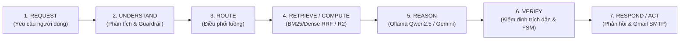
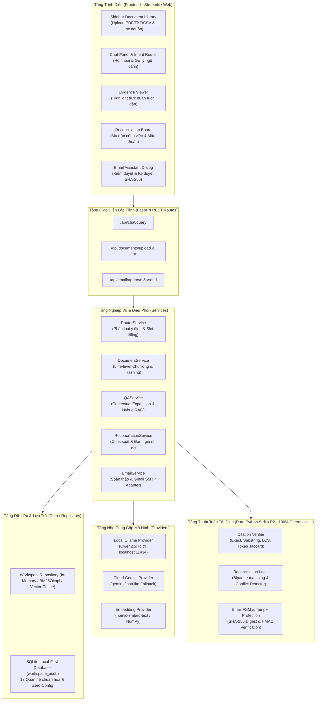
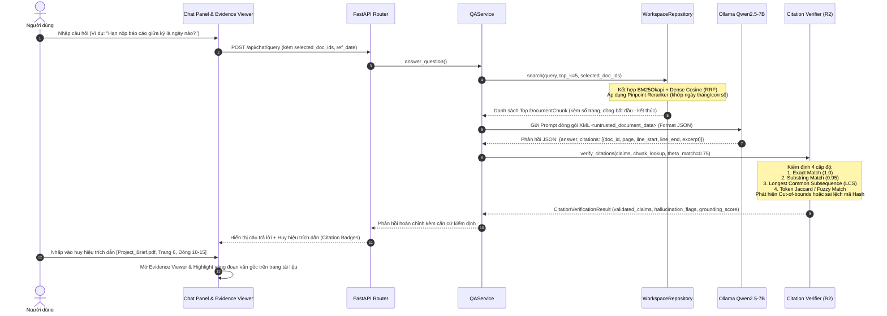
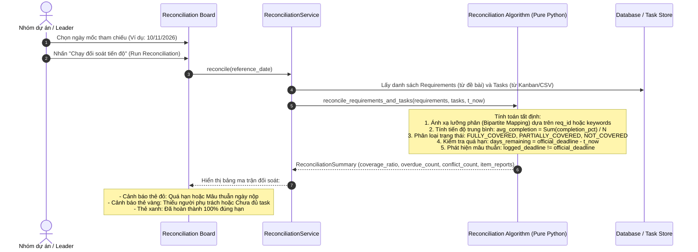
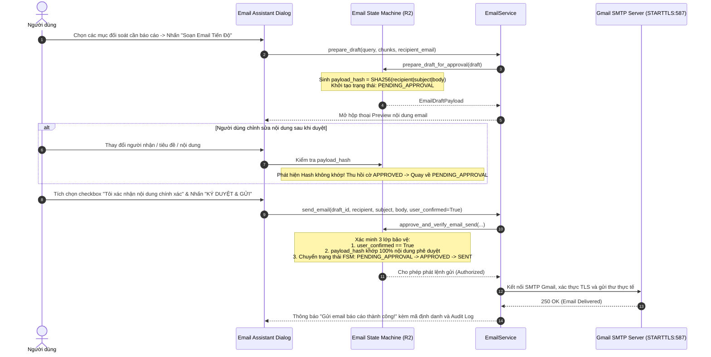
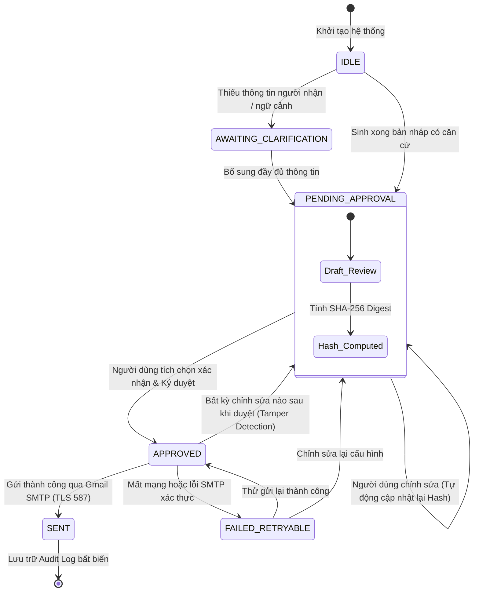
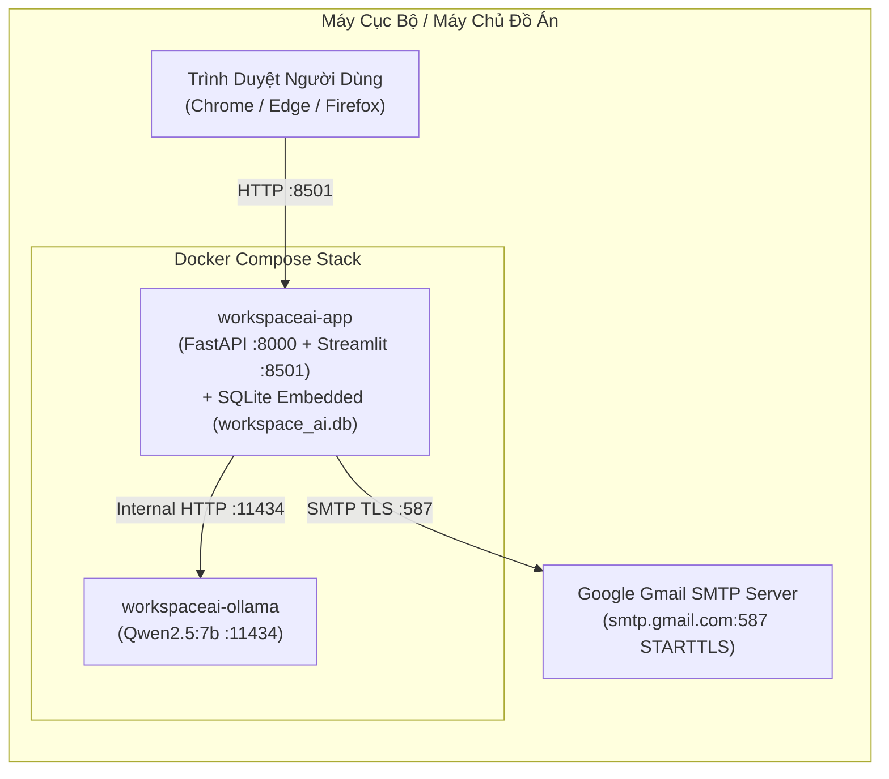

# WorkspaceAI — Kiến Trúc Hệ Thống & Quy Trình Hoạt Động (Workflows)

> **Môn học**: Tư duy tính toán (CSC10014) — Track C: Intelligent Document Workspace with Evidence Grounding  
> **Trường Đại học Khoa học Tự nhiên, ĐHQG-HCM (HCMUS)**  
> **Phiên bản hệ thống**: v2.5 Enterprise  

---

## 1. Tổng Quan Đường Ống CSC10014 Pipeline

Mọi yêu cầu từ người dùng (truy vấn tài liệu, kiểm tra tiến độ, soạn email) đều tuân thủ nghiêm ngặt chu trình 7 bước tính toán:

| Bước Pipeline | Thành phần phụ trách | Mô tả chi tiết |
| :--- | :--- | :--- |
| **1. REQUEST** | `frontend/components/chat_panel.py` | Tiếp nhận câu hỏi, văn bản tải lên, tập tài liệu đã chọn (`selected_doc_ids`), ngày mốc tham chiếu (`reference_date`). |
| **2. UNDERSTAND** | `backend/core/guardrails.py` | Quét kiểm tra prompt injection, bao đóng tài liệu trong thẻ `<untrusted_document_data>`, chuẩn hóa truy vấn. |
| **3. ROUTE** | `backend/services/router_service.py` | Phân loại ý định thành: `QA_FLOW`, `RECONCILE_FLOW`, `EMAIL_FLOW`, `CLARIFICATION_FLOW`, `REJECTED_SAFEGUARD`. |
| **4. RETRIEVE / COMPUTE** | `backend/repositories/workspace_repository.py` & `backend/algorithms/` | Truy xuất kết hợp Hybrid RRF (BM25 + Dense) hoặc thực thi thuật toán đối soát thuần Python Standard Library. |
| **5. REASON** | `backend/providers/llm_provider.py` | Kích hoạt LLM (Local Ollama Qwen2.5-7B hoặc Gemini API) sinh câu trả lời có cấu trúc JSON kèm trích dẫn gốc. |
| **6. VERIFY** | `backend/algorithms/citation_verifier.py` & `email_state_machine.py` | Thuật toán R2 đối soát 4 cấp độ kiểm tra từng claim; tính Grounding Score; băm SHA-256 payload email. |
| **7. RESPOND / ACT** | `backend/api/` & `frontend/` | Trả về kết quả có bằng chứng highlight trên Evidence Viewer hoặc kích hoạt gửi email sau khi người dùng ký duyệt. |

---

## 2. Kiến Trúc Phân Lớp (Layered Architecture)

---

## 3. Chi Tiết Quy Trình Nghiệp Vụ Chính (Core Workflows)

### 3.1. Workflow 1: Hỏi Đáp Có Căn Cứ Dẫn Chứng (Evidence-Grounded Q&A)

---

### 3.2. Workflow 2: Quản Lý & Đối Soát Tiến Độ Đồ Án (Progress Reconciliation)

---

### 3.3. Workflow 3: Soạn & Gửi Báo Cáo Email Có Giám Sát (Human-in-the-Loop Email Reporting)

---

## 4. Máy Trạng Thái Hữu Hạn Email (Email Finite State Machine)

Hệ thống bảo vệ chuyển trạng thái email nghiêm ngặt nhằm triệt tiêu nguy cơ gửi nhầm hoặc AI tự ý gửi thư:

---

## 5. Quy Chuẩn Đóng Gói & Triển Khai (Deployment Architecture)

Hệ thống hoàn toàn độc lập, đảm bảo quyền riêng tư dữ liệu học thuật (Local-First Privacy), không rò rỉ đề bài hay thông tin nội bộ của nhóm sinh viên ra ngoài Internet.
